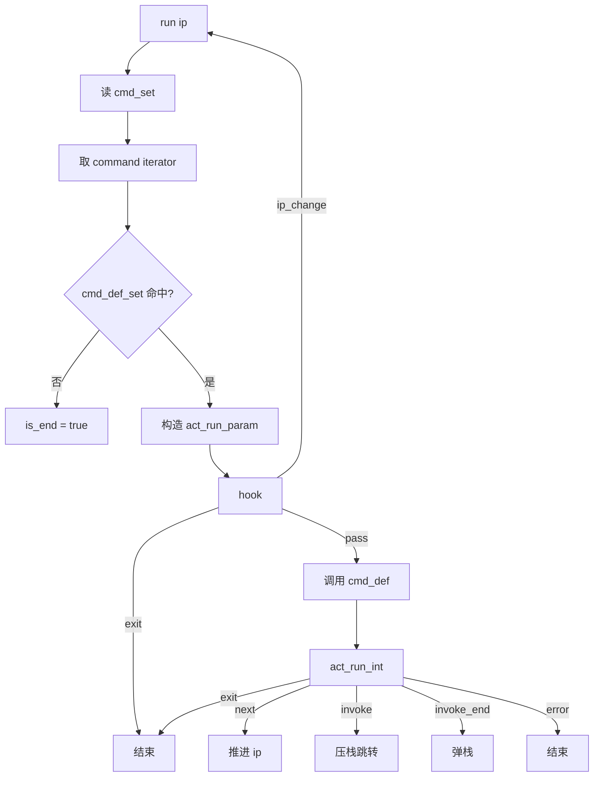

# rule_vm

> 一个 header-only、C++23、**可自修改、可序列化**的规则虚拟机。

## 简介

`rule_vm` 不是固定指令集解释器，而是一个“**规则即数据**”的 VM 内核。

它把程序拆成：

- **变量池**：稀疏 raw bytes；
- **命令池**：dense command，每条命令是“命令类型 + 操作数”；
- **操作数**：`imm` / `var` / `cmd` 三态，用 `handle_type` 描述解释方式；
- **调用栈与 ip**：保存执行位置和嵌套调用；
- **命令定义表**：`cmd_type` → 函数指针；
- **序列化层**：把上述全部状态写成带 CRC 的二进制文件。

因此，指令集不需要在编译期固定。调用方可以在 `rule_kit` 之上定义自己的 `cmd_type`、变量类型和 handler；内核只负责存储、解析、转换、执行和保存。

### 三个核心目的

|目的|内核中的体现|意义|
|---|---|---|
|**可自修改**|变量和命令都能在运行路径中被改写；`var_ptr` / `cmd_ptr` 可从变量内容中间接读取目标；命令 handler 可通过门面写回变量/命令|规则可以修改自己的数据，甚至改写后续要执行的规则|
|**可序列化**|header + var + cmd + stack/ip + CRC32；保存完整 VM 状态，加载后可 `resume`|程序状态可以持久化、迁移、恢复，而不是只能从入口重跑|
|**可嵌入**|header-only；allocator 贯穿；回调是函数指针；`rule_kit` 是唯一门面|可作为一个库嵌进宿主，不依赖固定运行时或文本前端|

### 设计核心：绝对索引

内核用“索引”而不是“指针/迭代器”来标识程序中的对象：

|对象|绝对定位|说明|
|---|---|---|
|命令|`cmd_set_index + cmd_index`|`run_ip` 就是这两个索引；跳转/保存/恢复都用它|
|变量|`var_mgr_index + var_index`|变量资源实例 + 变量编号；不依赖对象地址|
|操作数区间|`begin + width`|变量按字节；命令按 `cmd_op_single` 个数|
|命令内容|`cmd_sgl.index + content`|命令视图 + 操作数视图|
|调用栈|`run_ip` 序列|保存的是索引位置，不是函数指针|

这带来几个直接结果：

- **每条指令都可见**：命令在命令池中的位置是确定的，可按 `(cmd_set_index, cmd_index)` 直接定位；
- **可精确补丁**：改一条命令不需要“找到某个对象指针”，只需知道它的绝对索引；
- **可序列化**：保存的是索引和内容，不保存进程内地址，加载后仍能恢复执行；
- **可调试**：日志、断点、hook 都可以直接打印 `ip` 和操作数索引；
- **可生成**：新命令写入指定索引后，就能被后续 `run`/`cmd_ptr` 取到。

内核内部仍使用迭代器和 span 做高效访问，但它们只是**临时视图**；程序身份始终由索引表达。

### 它不是什么

- 不提供文本语法；
- 不规定具体指令集；
- 不规定 `cmd_type` / `var_type` 的业务含义；
- 不把 AST 作为运行时对象。

内核只规定“操作数如何表达、变量/命令如何存储、如何执行、如何序列化”。指令语义由调用方在 handler 中实现。

## 目录

|入门|深入|
|---|---|
|[简介](#简介)<br>[一页速览](#一页速览)<br>[语法特性](#语法特性)<br>[项目结构](#项目结构)<br>[快速开始](#快速开始)<br>[内核能做什么](#内核能做什么)|[内核基本语法规则](#内核基本语法规则)<br>[rule_kit 门面](#rule_kit-门面)<br>[Example](#example)<br>[序列化](#序列化)<br>[异常捕获](#异常捕获)|

## 一页速览

|问题|答案|
|---|---|
|程序是什么？|变量池 + 命令池 + 栈/ip；不是 AST|
|程序位置如何表示？|绝对索引：`(cmd_set_index, cmd_index)` 和 `(var_mgr_index, var_index)`|
|一条命令是什么？|`cmd_sgl = index + type 引用 + 操作数 span`|
|一个操作数是什么？|`imm_target` / `var_target` / `cmd_target` 三选一|
|操作数如何解释？|由 `handle_type` 决定：自身、类型、值、指针、删除目标|
|变量如何存？|按 `var_index` 排序；每个变量是稀疏块，`begin/width` 按字节|
|命令如何存？|dense；`begin/width` 按 `cmd_op_single` 个数|
|如何自修改？|handler 通过门面写变量/命令；`*_ptr` 支持间接目标|
|如何自动生成指令？|构造 `cmd_op_single` → `transform` 成 raw → `add_set_cmd_set` 写入|
|如何序列化？|固定 raw bytes 布局 + 大端字段 + CRC32|
|如何恢复？|`load` 恢复 var/cmd/stack/ip，再 `resume`|
|如何扩展？|定义 `cmd_type`、handler、变量类型编号，不改内核|

## 语法特性

|特性|内核中的规则|详细位置|
|---|---|---|
|**三态操作数**|每条操作数是 `imm_target`、`var_target`、`cmd_target` 之一|`cmd_op_single`|
|**数据驱动解释**|`handle_type` 决定解引用方式，不是 C++ 类型|`handle_type 的含义`|
|**立即数**|`imm_type` 决定有效字节数；`data` 固定 8 字节|`imm_type`|
|**变量**|稀疏块；`var_index` 定位；`begin/width` 以字节计|`var 的使用规则`|
|**命令**|dense；`cmd_type` 是 handler 键；`width` 以操作数个数计|`cmd_sgl 的使用规则`|
|**指针操作数**|`var_ptr` / `cmd_ptr` 从变量内容读取 48 字节目标|`handle_type 的含义`|
|**绝对索引**|命令/变量用池索引 + 索引定位，不依赖地址|`设计核心：绝对索引`|
|**raw bytes**|字段按 `uint64` 大端；固定 16/48/56 字节布局|`裸字节序列化布局`|
|**transform**|只做编码/解码，不检查资源存在性和范围|`transform 规则`|
|**自修改**|变量/命令可写；handler 可在执行中改写后续规则|`自修改如何组合出来`|
|**指令生成**|操作数 + 命令类型 + `add_set_cmd_set` 组合成新命令|`指令自动生成`|
|**完整序列化**|header + var + cmd + stack/ip + CRC32|`序列化`|

## 阅读路线

|目标|建议顺序|
|---|---|
|第一次了解内核|简介 → 一页速览 → 语法特性 → 内核基本语法规则 → 使用示例|
|实现一条指令|内核基本语法规则 → `rule_kit 门面` → 命令 handler 两种写法|
|排查解析/写回|`handle_type 的含义` → `transform 规则` → `rule_parse` / `rule_write`|
|做持久化|`裸字节序列化布局` → `序列化` → `rule_kit` 的 `save/load`|
|改存储层|`manager` → `variable` → `command` → `resource`|

## 功能特性

| 类别 | 能力 |
|---|---|
| 执行模型 | 取指 → 查表 → hook → 调用 → 栈/ip 状态推进 |
| 绝对索引 | 命令/变量/操作数都用索引定位；可打印、可补丁、可序列化 |
| 自修改 | 变量/命令可写；`var_ptr` / `cmd_ptr` 间接目标 |
| 数据语法 | `imm` / `var` / `cmd` 三态操作数；`handle_type` 数据驱动 |
| 存储 | 变量稀疏块、命令 dense 块、分页管理器、order/pos 缓存 |
| 生命周期 | 资源引用计数、变量引用计数、命令删除 |
| 回调 | 4 个函数指针回调；组合 `outer`，无 `std::function` |
| 序列化 | 流式读写、固定 raw 布局、CRC32、magic/version/`sizeof` 校验 |
| 错误 | 统一 `kernel_error`；诊断 `rule_int_info`；不可回滚抛 `kernel_error_throw` |
| 内存 | 单一 allocator 贯穿；门面复用操作数缓冲 |
| 部署 | header-only，C++23 |

## 项目结构

```text
rule_vm/
├── CMakeLists.txt
├── CMakePresets.json
├── README.md
├── LICENSE
├── .github/workflows/ci.yml
├── cmake/
│   └── rule_vmConfig.cmake.in
├── src/
│   ├── rule_kit.h              # 内核公开入口
│   └── kernel/                 # error / manager / variable / command /
│                               # resource / actuator / rule / serialize
├── example/
│   ├── rule_design.h           # rule_desg 入口
│   ├── rule_design_text.h
│   ├── rule_design/            # 示例指令集与文本前端
│   ├── demo_*.cpp              # 可运行示例
│   └── programs/               # .rule 示例脚本
└── tests/                      # 内核与示例测试
```

`src/` 只放内核；`example/` 放 `rule_desg` 和演示代码。内核不依赖 `example/`。

## 快速开始

```bash
cmake -S . -B build -DCMAKE_BUILD_TYPE=Release
cmake --build build --config Release
ctest --test-dir build -C Release --output-on-failure
```

Windows / 多配置生成器：

```powershell
cmake -S . -B build
cmake --build build --config Release
ctest --test-dir build -C Release --output-on-failure
```

只构建内核库：

```bash
cmake -S . -B build -DRULE_VM_BUILD_TESTS=OFF -DRULE_VM_BUILD_EXAMPLES=OFF
cmake --build build
```

也可以使用 CMake Presets：

```bash
cmake --preset default
cmake --build --preset default
ctest --preset default
```

在自己的 CMake 项目中使用：

```cmake
add_subdirectory(path/to/rule_vm)
target_link_libraries(your_target PRIVATE rule_vm::rule_vm)

# 需要 rule_desg 示例层时
target_link_libraries(your_target PRIVATE rule_vm::rule_vm_example)
```

构建出的示例：

```text
build/demo_basic          # 文本程序装载与执行
build/demo_manual         # C++ 直接构造类汇编程序
build/demo_self_modify    # 自修改命令
build/demo_codegen        # 指令自动生成
build/demo_serialize      # 保存/加载/resume
build/demo_copy           # 快照复制
build/demo_error          # 文本与运行时错误
build/demo_template       # 模板代码 + 自生成表达式
```

单配置生成器通常输出到 `build/`；Visual Studio 多配置生成器输出到 `build/Release/`（`.exe` 后缀）。

## 内核能做什么

以内核现有的索引、操作数、变量/命令和序列化能力，可以组合出以下用途：

|能力|如何实现|内核提供的支撑|
|---|---|---|
|**规则/策略执行**|把策略编译成 `cmd_type + 操作数`，注册 handler 后 `run`|命令池、操作数、执行器、回调|
|**类汇编程序**|每条命令有绝对 `(cmd_set_index, cmd_index)`|`run_ip`、命令索引、`cmd_sgl`|
|**自修改规则**|handler 写变量/命令；`var_ptr`/`cmd_ptr` 间接定位|`write_op_cont_span`、`add_set_*`、`*_ptr`|
|**指令自动生成**|构造 `cmd_op_single` → `transform` → 写入命令池|`transform`、`add_set_cmd_set`、命令定义表|
|**间接寻址/表驱动**|变量中保存 48 字节 `var_target`/`cmd_target`|`var_ptr` / `cmd_ptr`|
|**持久化快照**|保存 header + var + cmd + stack/ip + CRC|`save` / `load` / `resume`|
|**多实例隔离**|每个实例一个 `rule_kit` + `outer`|allocator、`rule_kit_outer`|
|**调试/审计**|打印 `ip`、操作数索引、`rule_int_info`|绝对索引、诊断上下文、回调|
|**宿主嵌入**|把内核当 header-only 库；handler 由宿主提供|无固定运行时、函数指针回调、allocator|

它不会替代宿主做这些事：

- **不提供安全沙箱**：handler 能做什么由宿主赋予；内核不限制变量/命令访问权限；
- **不提供文本前端**：文本语法、词法/语法分析由调用方实现；
- **不提供指令语义**：`cmd_type` 只负责查表，具体行为在 handler；
- **不提供通用垃圾回收**：资源/变量生命周期由引用计数和显式删除管理，业务对象由宿主负责；

因此它更适合做“可编程规则执行内核”，而不是一个完整的脚本语言运行时。

## 组件

| 组件 | 目录 | 命名空间 | 职责 |
|---|---|---|---|
| error | `src/kernel/error` | 全局 `kernel_error` | 错误码与异常载体 |
| manager | `src/kernel/manager` | `rule_manager` / `rule_page` / `rule_cache_mapping` / `rule_cache_prefix_mapping` | 分块容器、分页、缓存 |
| variable | `src/kernel/variable` | `rule_var` / `rule_var_cont` / `rule_var_data_def` | 变量表与单变量稀疏块 |
| command | `src/kernel/command` | `rule_cmd` / `rule_cmd_data_def` | 命令表与操作数 |
| resource | `src/kernel/resource` | `rule_rc` / `rule_rc_data_def` | 引用计数资源 |
| actuator | `src/kernel/actuator` | `rule_act` / `rule_act_data_def` / `rule_act_concept` | 解释循环、栈、回调 |
| rule | `src/kernel/rule` | `rule_tool` / `rule_data_def` / `rule_check` / `rule_parse` / `rule_transform` / `rule_write` / `rule_alloc` | 指令流水线与用户门面 |
| serialize | `src/kernel/serialize` | `rule_serialize` 及各子模块 | 保存与恢复 |

依赖方向：

```text
rule_tool / rule_kit
        ↓
rule_check / rule_parse / rule_transform / rule_write / rule_alloc
        ↓
resource
        ↓
command / variable
        ↓
manager / page / cache
        ↓
error
```

`actuator` 只依赖标准库和自身数据定义。

## 命名空间

内核不使用全局 `using namespace`。

内部短别名集中在 `kernel_namespace.h`：

```cpp
namespace pg        = ::rule_page;
namespace pg_data   = ::rule_page_data_def;
namespace cmap      = ::rule_cache_mapping;
namespace cmap_data = ::rule_cache_mapping_data_def;
namespace cmd_data  = ::rule_cmd_data_def;
namespace var_data  = ::rule_var_data_def;
namespace var_cont_data = ::rule_var_cont_data_def;
namespace act_data  = ::rule_act_data_def;
namespace rdata     = ::rule_data_def;
namespace tool      = ::rule_tool;
```

这些别名是内核内部约定，不是对外 API。

对外入口：

```cpp
#include "rule_kit.h"
```

公开类型统一在 `namespace rule_kit` 中，类型名统一以 `rule_kit_` 开头。

## 内核错误

### kernel_error

```cpp
enum class kernel_error;
```

命名格式：

```text
层__类型__方法__原因
```

例：

```cpp
variable__variable_manager__add_set__range_out_of_range
serialize__truncated
```

序列化错误码：

```text
serialize__magic_mismatch
serialize__version_mismatch
serialize__layout_mismatch
serialize__truncated
serialize__crc_mismatch
serialize__io_error
serialize__limit_exceeded
serialize__invalid_section
serialize__cmd_type_missing
serialize__var_restore_failed
serialize__cmd_restore_failed
serialize__manager_restore_failed
serialize__stack_restore_failed
```

### kernel_error_throw

```cpp
struct kernel_error_throw
{
public:
    kernel_error error_code;
    std::string error_msg;
public:
    template<typename self_this>
    decltype(auto) get_error_code(this self_this&& self);

    template<typename self_this>
    decltype(auto) get_error_msg(this self_this&& self);

    kernel_error_throw(kernel_error, const std::string&);
};
```

它不继承 `std::exception`，必须单独捕获。

### rule_int_info

`rule_int_info` 是执行诊断上下文，不是第二套错误枚举。

```cpp
struct rule_int_info
{
public:
    rule_int_t type_int;
    rule_int_info_base_error_t type_base_int;
    rule_int_info_cont cont_int;
};
```

`type_base_int` 可以携带 `kernel_error`。

`cont_int` 是以下类型之一：

```cpp
rule_int_info_cont_var
rule_int_info_cont_cmd
rule_int_info_cont_act
```

它用于说明：

- 哪个变量/指令；
- 哪个 manager；
- 哪个 index；
- 哪个操作数/位置/宽度；
- 失败阶段。

## manager 层

### manager

```cpp
template<
    typename T,
    std::size_t MAX = mgr_data::BLOCK_SIZE_DEFAULT,
    typename allocator_manager = std::allocator<T>>
class manager;
```

#### 类型成员

|类型别名|原类型|注释|
|---|---|---|
|**allocator_type**|`allocator_manager`|分配器|
|**value_type**|`T`|元素类型|
|**size_type**|`std::size_t`|数量类型|
|**difference_type**|`std::ptrdiff_t`|迭代器差值|
|**pointer / reference / reference_const**|`T*` / `T&` / `const T&`|元素访问类型|
|**iterator / const_iterator**|`manager_iterator_x<false, T, MAX, allocator_manager>` / `manager_iterator_x<true, T, MAX, allocator_manager>`|迭代器|
|**reverse_iterator / const_reverse_iterator**|`std::reverse_iterator<iterator>`|反向迭代器|
|**result_iterator**|`std::expected<iterator, kernel_error>`|返回迭代器的结果|
|**result_const_iterator**|`std::expected<const_iterator, kernel_error>`|常量版本|

#### 构造接口

|接口签名|注释|
|---|---|
|**manager()**|无参数。默认构造，使用默认分配器。|
|**explicit manager(const allocator_manager& allocator_val)**|`allocator_val` 为管理器分配器。|
|**explicit manager(const std::initializer_list<T>& params_list, const allocator_manager& allocator_val = allocator_manager())**|`params_list` 为初始元素列表；`allocator_val` 为分配器。插入失败抛 `kernel_error_throw`。|
|**template<std::forward_iterator iterator_type> explicit manager(const iterator_type& it_begin, const iterator_type& it_end, const allocator_manager& allocator_val = allocator_manager())**|`it_begin/it_end` 为元素区间；`allocator_val` 为分配器。插入失败抛 `kernel_error_throw`。|
|**manager(const manager& other_val)**|`other_val` 为复制源。|
|**manager(manager&& other_val) noexcept**|`other_val` 为移动源；不抛异常。|

#### 成员接口

|接口签名|注释|
|---|---|
|**constexpr std::size_t size() const noexcept**|无参数。返回当前元素数量（高水位，可能包含已删除但尚未整理的空洞）。不抛异常。|
|**constexpr bool empty() const noexcept**|无参数。返回是否没有元素。不抛异常。|
|**mgr_data::manager_result_src_ref<T> push_back(const T& src_new)**|`src_new` 为要插入的元素。返回新元素引用；失败返回 `kernel_error`。|
|**mgr_data::manager_result pop_back()**|无参数。删除尾元素；空时返回错误。|
|**template<typename...params> mgr_data::manager_result_src_ref<T> emplace(const const_iterator& it_emplace, params&&...src_new)**|`it_emplace` 为插入位置迭代器；`src_new...` 为元素构造参数。返回新元素引用；失败返回 `kernel_error`。|
|**template<typename...params> mgr_data::manager_result_src_ref<T> emplace_back(params&&...src_new)**|`src_new...` 为元素构造参数。返回尾部新元素引用。|
|**template<typename...params> result_iterator insert(const const_iterator& it_insert, params&&...src_new)**|`it_insert` 为插入位置；`src_new...` 为元素构造参数。返回新位置迭代器；失败返回错误。|
|**mgr_data::manager_result erase(const const_iterator& it_erase)**|`it_erase` 为要删除的迭代器位置。返回成功/错误；另有 `iterator`/反向迭代器重载。|
|**mgr_data::manager_result_src_ref<T> at(std::size_t order)**|`order` 为逻辑顺序下标。返回元素引用；越界返回错误。另有 const 版本。|
|**mgr_data::manager_result_src_ref<T> front()**|无参数。返回首元素引用；空时返回错误。|
|**mgr_data::manager_result_src_ref<T> back()**|无参数。返回尾元素引用；空时返回错误。|
|**mgr_data::manager_result_src_const_ref<T> operator[](std::size_t order) const**|`order` 为逻辑顺序下标。返回常量元素引用；越界返回错误。|
|**iterator begin() noexcept / const_iterator begin() const noexcept**|无参数。返回起始迭代器。不抛异常。|
|**iterator end() noexcept / const_iterator end() const noexcept**|无参数。返回结束迭代器。不抛异常。|
|**reverse_iterator rbegin() noexcept / rend() noexcept**|无参数。返回反向迭代器。不抛异常。|
|**bool is_valid(const iterator& it) const noexcept**|`it` 为待检查迭代器。返回它是否属于本管理器；另有 const/reverse 版本。不抛异常。|
|**void clear() noexcept**|无参数。清空元素，不释放全部分配器容量。不抛异常。|
|**void swap(manager& right) noexcept**|`right` 为另一个管理器。交换两者状态。不抛异常。|
|**mgr_data::manager_result shrink_to_fit()**|无参数。收缩内部容量；失败返回错误。|

`_ex` 变体（`insert_ex` / `erase_ex` / `emplace_ex` / `emplace_back_ex`）额外接收迭代器游标，用于避免重复定位；返回类型和错误语义与对应普通版本一致。管理器没有 `del_ex`。

### page

```cpp
template<
    typename T,
    std::size_t MAX,
    typename allocator_page>
class page;
```

`page` 没有公开类型别名；构造和操作如下。

|接口签名|注释|
|---|---|
|**page()**|无参数。默认构造，内部 `last=0`，缓存容量为 `MAX`。|
|**explicit page(const allocator_page& allocator_val)**|`allocator_val` 为页分配器；用于内部 set/free/cache。构造后缓存容量为 `MAX`。|
|**template<typename...params> pg_data::page_result_src<T> add(params&&...src_new)**|`src_new...` 为元素构造参数；在页尾添加元素。返回元素引用；失败返回 `kernel_error`。|
|**template<typename...params> pg_data::page_result_src<T> insert_front(pg_data::index_page_order index, params&&...src_new)**|`index` 为插入位置；`src_new...` 为元素构造参数。返回新元素引用。|
|**pg_data::page_result del(pg_data::index_page_order index)**|`index` 为要删除的逻辑位置。返回成功/错误，并维持元素链。|
|**constexpr pg_data::page_result_src<T> get(pg_data::index_page_order index) noexcept**|`index` 为逻辑位置。返回元素引用；越界返回错误。|
|**constexpr pg_data::page_result_const_src<T> get_const(pg_data::index_page_order index) const noexcept**|`index` 为逻辑位置。返回常量元素引用；越界返回错误。|
|**constexpr pg_data::page_result write(pg_data::index_page_order index, const T& src_new) noexcept**|`index` 为目标位置；`src_new` 为要写入的新元素。返回成功/错误。|
|**pg_data::page_result cut(page& page_other, pg_data::index_page_order index_begin, pg_data::index_page_order index_end, pg_data::index_page_order index_save_begin)**|`page_other` 为目标页；`index_begin/index_end` 是本页要搬移的区间；`index_save_begin` 是目标页保存起点。失败时尝试回滚。|
|**constexpr std::size_t get_size() const noexcept**|无参数。返回当前有效元素数量。不抛异常。|
|**constexpr std::size_t get_size_left() const noexcept**|无参数。返回剩余容量。不抛异常。|
|**constexpr bool empty() const noexcept**|无参数。返回是否为空。不抛异常。|
|**void rebuild()**|无参数。调用内部 `tidy_element(true)` 整理空闲位置并重建缓存。|

### cache_mapping

```cpp
template<
    typename T,
    typename U,
    std::size_t MAX,
    typename allocator_cache = std::allocator<U>>
class cache_mapping;
```

维护 order → pos 映射。

|接口签名|注释|
|---|---|
|**explicit cache_mapping(const allocator_cache& allocator_val, std::size_t size_val)**|`allocator_val` 为分配器；`size_val` 为初始容量。|
|**explicit cache_mapping(const allocator_cache& allocator_val)**|`allocator_val` 为分配器；初始容量由默认构造决定。|
|**cmap_data::cache_mapping_result add_set(T cache_order_new, U cache_pos_new)**|`cache_order_new` 是 order 键；`cache_pos_new` 是对应 pos。写入/覆盖映射；order 超限或扩容失败返回错误。|
|**cmap_data::cache_mapping_result insert_front(T cache_order_insert, U cache_pos_new)**|`cache_order_insert` 是插入位置 order；`cache_pos_new` 是新 pos。在 order 前插入。|
|**cmap_data::cache_mapping_result insert_back(T cache_order_insert, U cache_pos_new)**|`cache_order_insert` 是插入位置 order；`cache_pos_new` 是新 pos。在 order 后插入。|
|**constexpr cmap_data::cache_mapping_result_pos<U> get(T index) const noexcept**|`index` 是 order 键。返回对应 pos；越界或无效返回错误。|
|**constexpr cmap_data::cache_mapping_result_pos<U> get_next(T index) const noexcept**|`index` 是 order 键。返回下一个 order 的 pos。|
|**constexpr cmap_data::cache_mapping_result_pos<U> get_last(T index) const noexcept**|`index` 是 order 键。返回上一个 order 的 pos。|
|**constexpr cmap_data::cache_mapping_result_pos<U> get_front() const noexcept**|无参数。返回第一个映射。|
|**constexpr cmap_data::cache_mapping_result_pos<U> get_back() const noexcept**|无参数。返回最后一个映射。|
|**cmap_data::cache_mapping_result del(T index)**|`index` 是要删除的 order 键。返回成功/错误。|
|**void clear() noexcept**|无参数。清空全部映射。不抛异常。|
|**void swap(cache_mapping& other)**|`other` 为另一个映射表。交换两者状态。|

### cache_prefix_mapping

```cpp
template<
    typename T,
    typename U,
    typename allocator_cache = std::allocator<T>>
class cache_prefix_mapping;
```

维护隐式前缀和。

|类型别名|原类型|注释|
|---|---|---|
|**sum_type**|`std::common_type_t<U, std::int64_t>`|前缀和类型|
|**size_type**|`std::uint64_t`|大小类型|
|**sum_result**|`cache_prefix_mapping_result_value<sum_type>`|和结果|
|**locate_result**|`cache_prefix_mapping_result_value<std::pair<T, sum_type>>`|定位结果|

|接口签名|注释|
|---|---|
|**cache_prefix_mapping()**|无参数。默认构造，空树、无随机数状态。|
|**explicit cache_prefix_mapping(const allocator_cache& allocator_val)**|`allocator_val` 为节点/随机数分配器。|
|**cpmap_data::cache_prefix_mapping_result push_back(const T& key, const U& value)**|`key` 为新节点键；`value` 为节点值。返回成功/错误。|
|**cpmap_data::cache_prefix_mapping_result insert(size_type pos, const T& key, const U& value)**|`pos` 为插入位置；`key/value` 为新节点内容。返回成功/错误。|
|**bool erase(size_type pos) noexcept**|`pos` 为删除位置。返回是否删除成功。不抛异常。|
|**cpmap_data::cache_prefix_mapping_result update(size_type pos, const U& value)**|`pos` 为位置；`value` 为新值。返回成功/错误。|
|**constexpr bool get(size_type pos, T& out_key, U& out_value) const noexcept**|`pos` 为位置；`out_key` 输出键；`out_value` 输出值。返回是否读取成功。不抛异常。|
|**constexpr bool empty() const noexcept**|无参数。返回是否为空。不抛异常。|
|**constexpr size_type size() const noexcept**|无参数。返回节点数量。不抛异常。|
|**constexpr sum_type total_sum() const noexcept**|无参数。返回全部值的前缀和。不抛异常。|
|**void clear() noexcept**|无参数。清空树和随机数状态。不抛异常。|
|**void swap(cache_prefix_mapping& other)**|`other` 为另一个映射；交换树和随机数状态。|

## variable 层

### variable_manager

```cpp
template<
    typename T,
    typename var_mgr_alloc = std::allocator<T>>
class variable_manager;
```

#### 类型成员

|类型别名|原类型|注释|
|---|---|---|
|**allocator_type**|`var_mgr_alloc`|分配器|
|**value_type**|`T`|变量原始元素类型|
|**size_type**|`std::size_t`|数量|
|**index_type**|`var_cont_data::var_index`|变量索引|
|**index_this_type**|`var_cont_data::var_mgr_index`|资源实例索引|
|**iterator / const_iterator**|`mgr_ns::container_plus<var_data::var_sgl<value_type, var_mgr_alloc>, var_set_allocator>::iterator`|按变量索引排序的迭代器|
|**reverse_iterator / const_reverse_iterator**|同上容器的反向迭代器|反向迭代器|

#### 构造接口

|接口签名|注释|
|---|---|
|**variable_manager()**|无参数。默认构造，使用默认分配器。|
|**explicit variable_manager(const var_mgr_alloc& alloc_val)**|`alloc_val` 为变量表分配器。|
|**variable_manager(const variable_manager& other_val)**|`other_val` 为复制源变量表。|
|**variable_manager(variable_manager&& other_val) noexcept**|`other_val` 为移动源；不抛异常。|

#### 成员接口

|接口签名|注释|
|---|---|
|**var_data::var_mgr_res add_set(var_cont_data::var_index index, var_cont_data::var_type type, var_cont_data::var_pos pos_write_begin, const std::span<const value_type>& span_write, bool is_increase_ref = true, bool is_dense = false)**|`index` 为变量编号；`type` 为类型标签；`pos_write_begin` 为字节起点；`span_write` 为内容；`is_increase_ref` 控制引用递增；`is_dense` 控制块是否必须连续。变量不存在时创建。|
|**var_data::var_mgr_res add_set(var_cont_data::var_index index, var_cont_data::var_type type, var_cont_data::var_pos pos_write_begin, var_cont_data::var_read_width width_write_fill, bool is_increase_ref = true, bool is_dense = false)**|同上，但用 `width_write_fill` 指定写入宽度而非 span。|
|**var_data::var_mgr_res add_set_ex(var_cont_data::var_index index, var_cont_data::var_type type, var_cont_data::var_pos pos_write_begin, const std::span<const value_type>& span_write, bool is_increase_ref, iterator& it_cursor, bool is_dense = false)**|参数含义同 `add_set`，另用 `it_cursor` 作为定位游标。|
|**var_data::var_mgr_res add_set_ex(var_cont_data::var_index index, var_cont_data::var_type type, var_cont_data::var_pos pos_write_begin, var_cont_data::var_read_width width_write_fill, bool is_increase_ref, iterator& it_cursor, bool is_dense = false)**|同上，用 `width_write_fill` 指定宽度。|
|**var_data::var_mgr_res_span<value_type> read(var_cont_data::var_index index, var_cont_data::var_pos get_begin, var_cont_data::var_read_width read_width)**|`index` 为变量编号；`get_begin` 为字节起点；`read_width` 为读取宽度。返回内容 span；失败返回错误。|
|**var_data::var_mgr_res_var_sgl<value_type, var_mgr_alloc> get(var_cont_data::var_index index)**|`index` 为变量编号。返回变量单例；不存在返回错误。|
|**var_data::var_mgr_res_var_sgl_const<value_type, var_mgr_alloc> get(var_cont_data::var_index index) const**|`index` 为变量编号。返回常量变量单例。|
|**var_data::var_mgr_res_size<size_type> get_size(var_cont_data::var_index index) const**|`index` 为变量编号。返回变量内容大小；不存在返回错误。|
|**var_data::var_mgr_res_size<size_type> get_ref(var_cont_data::var_index index) const**|`index` 为变量编号。返回当前 `ref`；不存在返回错误。|
|**var_data::var_mgr_res del(var_cont_data::var_index index)**|`index` 为变量编号。删除变量；`ref` 归零时真正销毁。|
|**var_data::var_mgr_res del(var_cont_data::var_index index, var_cont_data::var_pos pos_del_begin, var_cont_data::var_read_width width_del, bool is_del_full_span = false)**|`index` 为变量；`pos_del_begin/width_del` 为删除区间；`is_del_full_span` 为真时若删满整段则连同变量删除。|
|**var_data::var_mgr_res del_ex(var_cont_data::var_index index, iterator& it_cursor)**|`index` 为变量；`it_cursor` 为定位游标。带游标删除变量。|
|**var_data::var_mgr_res del_it_ex(iterator it, iterator& it_cursor)**|`it` 为变量迭代器；`it_cursor` 为定位游标。带游标按迭代器删除。|
|**bool restore_var(var_cont_data::var_index index, var_cont_data::var_type type, var_cont_data::var_ref ref)**|`index` 为变量编号；`type` 为类型；`ref` 为恢复的引用计数。返回是否成功。|
|**void clear() noexcept**|无参数。清空变量表。不抛异常。|
|**bool empty() const noexcept**|无参数。返回是否为空。不抛异常。|
|**iterator begin() noexcept / end() noexcept**|无参数。返回迭代器。|
|**reverse_iterator rbegin() noexcept / rend() noexcept**|无参数。返回反向迭代器。|

### var_content

```cpp
template<
    typename T,
    typename var_cont_alloc = std::allocator<T>>
class var_content;
```

单变量稀疏块存储。

|类型别名|原类型|注释|
|---|---|---|
|**allocator_type**|`var_cont_alloc`|分配器|
|**value_type**|`T`|元素类型|
|**size_type**|`std::size_t`|位置/大小类型|

|接口签名|注释|
|---|---|
|**var_content()**|无参数。空内容构造。|
|**var_content(size_type size, value_type var_content_val = value_type())**|`size` 为元素数量；`var_content_val` 为每个元素的初始值。|
|**var_cont_data::var_cont_res_span<value_type> read(var_cont_data::var_pos pos_begin, var_cont_data::var_read_width width)**|`pos_begin` 为字节起点；`width` 为读取宽度。返回区间 span；不存在返回错误。|
|**var_cont_data::var_cont_res_span<value_type> ensure(var_cont_data::var_pos pos_begin, var_cont_data::var_read_width width)**|`pos_begin` 为字节起点；`width` 为需要保证的宽度。返回可写 span；可能扩展块。|
|**var_cont_data::var_cont_res ensure_dense(var_cont_data::var_read_width width_new)**|`width_new` 为需要连续的宽度；保证 `[0,width_new)`。返回成功/错误。|
|**var_cont_data::var_cont_res del(var_cont_data::var_pos pos_begin, var_cont_data::var_read_width width)**|`pos_begin` 为字节起点；`width` 为删除宽度。返回成功/错误。|
|**var_cont_data::var_cont_res_set<value_type, allocator_type> get()**|无参数。返回块集合的可写引用。|
|**var_cont_data::var_cont_res_set_const<value_type, allocator_type> get() const**|无参数。返回块集合的常量引用。|
|**bool empty() const**|无参数。返回是否没有内容。|
|**bool restore_block(var_cont_data::var_pos pos, std::span<const value_type> data)**|`pos` 为块起点；`data` 为块内容。反序列化恢复一个块；返回是否成功。|

## command 层

### command_manager

```cpp
template<
    typename cmd_mgr_alloc = std::allocator<cmd_data::cmd_op_single>>
class command_manager;
```

|类型别名|原类型|注释|
|---|---|---|
|**allocator_type**|`cmd_mgr_alloc`|分配器|
|**value_type**|`cmd_data::cmd_single<false>`|可变命令类型|
|**const_value_type**|`cmd_data::cmd_single<true>`|常量命令类型|
|**command_type**|`value_type`|命令类型别名|
|**size_type**|`variable_manager<cmd_op_single, cmd_mgr_alloc>::size_type`|大小类型|
|**index_type**|`cmd_data::cmd_index`|命令索引|
|**index_this_type**|`cmd_data::cmd_mgr_index`|资源实例索引|
|**command_define_id_type**|`cmd_data::cmd_type`|命令定义类型|
|**iterator / const_iterator**|`cmd_mgr_iterator<typename var_mgr_ns::variable_manager<cmd_data::cmd_op_single, cmd_mgr_alloc>::iterator>` / 对应 const 版本|迭代器|

|接口签名|注释|
|---|---|
|**command_manager() = default**|无参数。默认构造，使用默认分配器。|
|**explicit command_manager(const cmd_mgr_alloc& allocator_val)**|`allocator_val` 为命令表分配器。|
|**cmd_data::cmd_mgr_res add_set(cmd_data::cmd_index index, cmd_data::cmd_type type, cmd_data::cmd_op_index pos_write_begin, const std::span<const cmd_data::cmd_op_single>& span_op_write, bool is_increase_ref = true)**|`index` 为命令编号；`type` 为命令类型；`pos_write_begin` 为操作数起点；`span_op_write` 为操作数内容；`is_increase_ref` 控制引用递增。|
|**cmd_data::cmd_mgr_res add_set(cmd_data::cmd_index index, cmd_data::cmd_type type, cmd_data::cmd_op_index pos_write_begin, cmd_data::cmd_op_width width_write_fill, bool is_increase_ref = true)**|同上，用 `width_write_fill` 指定填充宽度。|
|**cmd_data::cmd_mgr_res add_set_ex(cmd_data::cmd_index index, cmd_data::cmd_type type, cmd_data::cmd_op_index pos_write_begin, const std::span<const cmd_data::cmd_op_single>& span_op_write, bool is_increase_ref, iterator& it_cursor)**|参数同 span 版 `add_set`，另用 `it_cursor` 定位。|
|**cmd_data::cmd_mgr_res add_set_ex(cmd_data::cmd_index index, cmd_data::cmd_type type, cmd_data::cmd_op_index pos_write_begin, cmd_data::cmd_op_width width_write_fill, bool is_increase_ref, iterator& it_cursor)**|参数同宽度版 `add_set`，另用 `it_cursor` 定位。|
|**cmd_data::cmd_mgr_res_cmd<value_type> get(cmd_data::cmd_index index)**|`index` 为命令编号。返回可变命令视图；不存在返回错误。|
|**cmd_data::cmd_mgr_res_cmd<const_value_type> get(cmd_data::cmd_index index) const**|`index` 为命令编号。返回常量命令视图。|
|**cmd_data::cmd_mgr_res_size<size_type> get_ref(cmd_data::cmd_index index) const**|`index` 为命令编号。返回引用计数。|
|**cmd_data::cmd_mgr_res_size<size_type> get_op_size(cmd_data::cmd_index index) const**|`index` 为命令编号。返回操作数数量。|
|**cmd_data::cmd_mgr_res_cmd_single_it<iterator> get_it(cmd_data::cmd_index index)**|`index` 为命令编号。返回命令迭代器。|
|**cmd_data::cmd_mgr_res del(cmd_data::cmd_index index)**|`index` 为命令编号。删除命令。|
|**cmd_data::cmd_mgr_res del_it(iterator_type&& it)**|`it` 为命令迭代器。按迭代器删除。|
|**void clear() noexcept**|无参数。清空命令表。不抛异常。|
|**cmd_data::cmd_mgr_res shrink_to_fit()**|无参数。收缩容量。|
|**bool empty() const noexcept**|无参数。返回是否为空。不抛异常。|
|**iterator begin() / end()**|无参数。返回迭代器。|

## 内核基本语法规则

这一节描述内核真正认识的最小语法单位：

```text
imm_target
var_target
cmd_target
cmd_op_single
cmd_single / cmd_sgl
```

它们不是“指令集语法”，而是内核用于表达“一个操作数从哪里来、指向什么、宽度多少、如何解释”的基础数据结构。

### 类汇编结构

内核不提供文本 parser，但它的数据布局是**类汇编**的：

```text
command  ::= cmd_type operand*
operand  ::= imm | var | cmd
imm      ::= imm_type data[8]
var      ::= var_mgr_index : var_index [begin .. begin+width] @handle_type
cmd      ::= cmd_mgr_index : cmd_index [begin .. begin+width] @handle_type
ip       ::= cmd_mgr_index : cmd_index
```

用更接近汇编的写法表示：

```text
<cmd_type>  var#0:0[0..8]  imm.qword(4)
<cmd_type>  var#0:1[0..8]  cmd#0:2[0..1]
<cmd_type>  var_ptr#0:3    imm.byte(1)
```

这些助记符不是内核语法，只是本文档的阅读记号。内核真正保存的是：

```text
cmd_type
+ cmd_op_single[]
+ 每个 cmd_op_single 的 handle_type / ownership / index / begin / width
```

因此它同时具备两种视角：

|视角|看到什么|
|---|---|
|**汇编视角**|一条命令 = 一个 `cmd_type` + 若干操作数；命令有确定的 `(cmd_set_index, cmd_index)`|
|**数据视角**|命令只是命令池中的一段 `cmd_op_single`；变量只是变量池中的稀疏字节块|

“绝对索引”是这两种视角的连接点：汇编位置用索引表示，数据内容也用索引定位。

### 基础标量

|类型|底层类型|用途|
|---|---|---|
|**var_index**|`std::uint64_t`|变量编号|
|**var_type**|`std::uint64_t`|变量类型标签|
|**var_pos**|`std::uint64_t`|变量内字节位置|
|**var_ref**|`std::uint64_t`|变量引用计数|
|**var_mgr_index**|`std::uint64_t`|变量资源实例编号|
|**var_read_width**|`std::uint64_t`|变量读取宽度（字节）|
|**cmd_index**|`var_index`|命令编号|
|**cmd_type**|`std::uint64_t`|命令类型/定义键|
|**cmd_mgr_index**|`std::uint64_t`|命令资源实例编号|
|**cmd_op_index**|`var_pos`|命令操作数下标|
|**cmd_op_width**|`std::uint64_t`|命令操作数数量|
|**op_var_type**|`std::uint16_t`|变量 handle_type|
|**op_cmd_type**|`std::uint16_t`|命令 handle_type|
|**imm_type**|`std::uint8_t`|立即数类型|
|**cmd_op_type**|`std::uint8_t`|操作数种类|

所有 raw bytes 的数值字段最终都按 `std::uint64_t` 编码；`imm_target::data` 是字节数组，例外。

### 操作数总览

|类型|组成|作用|
|---|---|---|
|**imm_target**|`imm_type type; std::array<cmd_var_base_type, 8> data;`|立即数操作数。`type` 决定有效字节数，`data` 固定 8 字节存储。|
|**var_target**|`op_var_type handle_type; var_mgr_index ownership; var_index index; var_type type; var_pos begin; var_read_width width;`|变量操作数。描述变量池、变量索引、变量内位置和解释方式。|
|**cmd_target**|`op_cmd_type handle_type; var_cmd_mgr_index ownership; var_cmd_index index; var_cmd_type type; var_cmd_begin_pos begin; cmd_op_width width;`|命令操作数。描述命令池、命令索引、命令操作数区间和解释方式。|
|**cmd_op_single**|`std::variant<imm_target, var_target, cmd_target>`|单条操作数，三选一。|
|**cmd_single / rule_kit_cmd_sgl**|`cmd_index index; reference_wrapper<cmd_type> type; span<cmd_op_single> content;`|一条完整命令：命令索引、命令类型引用、操作数视图。|

#### var_target 字段

|字段|类型|单位/含义|
|---|---|---|
|**handle_type**|`op_var_type`|解释模式，见下表|
|**ownership**|`var_mgr_index`|变量资源实例编号|
|**index**|`var_index`|实例内变量编号|
|**type**|`var_type`|用户类型标签|
|**begin**|`var_pos`|变量内起始位置，按字节|
|**width**|`var_read_width`|读取/写入宽度，按字节|

#### cmd_target 字段

|字段|类型|单位/含义|
|---|---|---|
|**handle_type**|`op_cmd_type`|解释模式，见下表|
|**ownership**|`var_cmd_mgr_index`|命令资源实例编号|
|**index**|`var_cmd_index`|实例内命令编号|
|**type**|`var_cmd_type`|命令类型标签|
|**begin**|`var_cmd_begin_pos`|命令内起始位置，按操作数个数|
|**width**|`cmd_op_width`|操作数个数|

#### imm_target 字段

|字段|类型|含义|
|---|---|---|
|**type**|`imm_type`|有效字节数和解释方式|
|**data**|`std::array<std::byte, 8>`|固定 8 字节原始数据|

### handle_type 的含义

`handle_type` 不是 C++ 类型，也不是“句柄地址”，而是**操作数解释模式**。

#### 变量 handle_type

|值|含义|解析行为|
|---|---|---|
|**var_type**|读取变量类型|定位变量后返回变量类型，不读取内容。|
|**var_self**|操作数自身|不做变量解引用，指令直接使用 `var_target` 字段。|
|**var_tgt**|变量目标|不做值解引用，通常用于写回/分配目标。|
|**var_val**|变量值|按 `begin/width` 读取变量内容，返回内容 span。|
|**var_ptr**|变量内的指针|从变量 `begin` 处读取 48 字节，按 `var_target` 解码，再解引用到真正的变量。`width` 不参与指针读取。|
|**var_del**|删除变量目标|不做值解引用，通常用于删除操作。|
|**invalid**|无效|解析失败。|

#### 命令 handle_type

|值|含义|解析行为|
|---|---|---|
|**cmd_type**|读取命令类型|定位命令后返回命令类型，不读取操作数。|
|**cmd_self**|命令操作数自身|不做命令解引用，指令直接使用 `cmd_target` 字段。|
|**cmd_tgt**|命令目标|不做值解引用，通常用于写回/分配目标。|
|**cmd_val**|命令操作数|按 `begin/width` 读取命令的 `cmd_op_single` 区间。`width` 以操作数个数计。|
|**cmd_ptr**|变量内的命令指针|从变量 `begin` 处读取 48 字节，按 `cmd_target` 解码，再解引用到真正的命令。`width` 不参与指针读取。|
|**cmd_del**|删除命令目标|不做值解引用，通常用于删除操作。|
|**invalid**|无效|解析失败。|

### imm_type

|值|有效字节|说明|
|---|---:|---|
|**self**|0|立即数自身，不读取 `data`；用于“把操作数本身作为目标”。|
|**byte**|1|取 `data[0]`。|
|**word**|2|取 `data[0..2)`。|
|**dword**|4|取 `data[0..4)`。|
|**qword**|8|取 `data[0..8)`。|
|**invalid**|—|无效。|

`imm_target::data` 固定为 8 字节；`transform` 只复制这 8 字节，不逐字段做字节序转换。若指令把 `data` 当作数值解释，需要调用方自己保证字节序和宽度约定。

### var 的使用规则

|规则|说明|
|---|---|
|变量表按 `index` 升序|`variable_manager` 使用有序容器，按 `var_index` 查找。|
|变量是稀疏块|`var_content` 由多个 `var_block` 组成，块可以远离 0，块之间可以有空洞。|
|`begin/width` 以字节计|`var_target` 和变量内容读取都使用字节位置/字节宽度。|
|`read` 不扩容|`var_content::read` 只读取已存在区间；区间不存在返回错误。|
|`ensure` 才扩容|需要扩大/创建区间时使用 `var_content::ensure` 或 `ensure_dense`。|
|`var_sgl` 保存 index/type/ref/content|`var_sgl` 是变量单例；`ref` 是引用计数，`content` 是稀疏块。|
|`var_type` 是用户类型标签|内核只存储/传递 `var_type`，不解释它的业务含义；指令实现自行定义类型编号。|
|`cmd_type` 是命令定义键|`cmd_type` 用于在命令定义表中查找执行函数，必须与 `add_set_cmd_def` 注册的键一致。|
|`get` 不自动加引用|`variable_manager::get` 只返回变量视图，不增加 `ref`；需要增加引用时走 `add_set`/资源分配路径，不要手动改 `ref`。|
|`var_val` 读内容|`var_val` 用 `begin/width` 读取变量内容，返回 span。|
|`var_type` 只读类型|`var_type` 不读取内容，只返回变量类型。|
|`var_ptr` 是二级变量|变量内容的前 48 字节被当作一个 `var_target`，解码后再访问目标变量。|
|`var_self`/`var_tgt`/`var_del` 不解引用|指令拿到的是目标元数据，自己决定如何写回或删除。|
|`ref == 0` 可销毁|引用计数归零后变量才真正从表中移除；不要绕过管理器手动删除。|

### cmd_sgl 的使用规则

|规则|说明|
|---|---|
|`cmd_sgl` 是命令视图|包含 `index`、`type` 引用和 `content` span，不拥有命令存储。|
|`cmd_sgl.index` 是绝对命令索引|与 `cmd_set_index` 一起构成 `run_ip`；跳转/保存/恢复都不依赖指针。|
|`cmd_single<true>` 是常量版本|`type` 变为 `reference_wrapper<const cmd_type>`，`content` 变为 `span<const cmd_op_single>`。|
|`type` 是引用|指向命令管理器中的类型字段；命令删除/重建后失效。|
|`content` 是操作数视图|指向命令管理器中的 `cmd_op_single` 连续区间；写入/扩容后失效。|
|`begin/width` 以操作数个数计|`cmd_val` 的 `width` 是 `cmd_op_single` 元素数量，不是字节数。|
|`cmd_ptr` 指向变量|`cmd_ptr` 从变量内容读取 48 字节 `cmd_target`，再定位命令。|
|`cmd_type`/`cmd_val` 才解引用命令|`cmd_self`/`cmd_tgt`/`cmd_del` 只返回 `cmd_target` 元数据。|

### ip 与绝对索引

`run_ip` 是执行位置的唯一定位方式：

```cpp
struct act_cmd_ip
{
    command_set_index cmd_set_index;  // 命令资源实例
    command_index index;              // 实例内命令索引
};
```

|字段|类型|说明|
|---|---|---|
|`cmd_set_index`|`cmd_mgr_index`|命令资源池实例|
|`index`|`cmd_index`|实例内命令编号|

调用栈保存的是 `run_ip` 序列：

```text
stack: [ip_return_1, ip_return_2, ...]
```

因此：

- `invoke` 压入的是返回位置，不是函数指针；
- `resume` 用保存的 `run_ip` 继续；
- `save/load` 保存 `run_ip`，加载后仍能定位；
- `hook`/错误回调修改的也是 `run_ip`；
- 命令的绝对索引由 `cmd_set_index + cmd_index` 共同确定，不会因为容器扩容而改变。

### cmd_op_type

`cmd_op_type` 用于校验操作数种类，不是 raw 编码：

|值|含义|
|---|---|
|**imm**|只接受立即数|
|**var**|只接受变量目标|
|**cmd**|只接受命令目标|
|**both**|接受变量或命令目标|

### 从命令到操作数：一次解析的完整过程

可以把一次解析理解成四步：

```text
cmd_sgl（命令视图）
    ↓ 取 content[op_index]
cmd_op_single（imm / var / cmd）
    ↓ handle_type 解码
op_cont（解析结果）
    ↓ 投影
op_span（raw bytes / target / cmd_op / op_del）
```

|阶段|输入|门面接口|输出|失败时|
|---|---|---|---|---|
|取命令|命令池 / 当前命令|`cmd_info.cmd_sgl`|`cmd_sgl`|命令不存在由调用方处理|
|解析操作数|`cmd_sgl` + 操作数下标|`get_op_parse` / `get_op_parse_ex`|`span<op_cont>`|返回 `nullopt`，写 `int_info`|
|投影|`span<op_cont>`|`get_op_cont_span`|`span<op_span>`|返回 `nullopt`，可能抛 `std::bad_alloc`|
|写回|两个 `op_cont`|`write_op_cont_span`|`bool`|返回 `false`，写 `int_info`|

#### `op_cont` 是什么

`op_cont` 是 `parse_data::op<alloc>` 的别名，表示“解析后的操作数”。

| variant | 包含 | 含义 |
|---|---|---|
|`std::monostate`|无|无效操作数|
|`op_imm`|`op_ow`、可选 `imm_span`|立即数；`self` 时 `imm_span` 为空|
|`op_var`|`op_ow`、`var_tgt`、可选 `var_info_val`、可选 `var_info_ptr`|变量目标；`var_val`/`var_ptr` 时带解析后的变量信息|
|`op_cmd`|`op_ow`、`cmd_tgt`、可选 `cmd_info_val`、可选 `cmd_info_ptr`|命令目标；`cmd_val`/`cmd_ptr` 时带解析后的命令信息|

`op` 只保存视图/引用，不拥有变量或命令；`op_ow` 指回原始 `cmd_op_single`。

#### `op_span` 是什么

`op_span` 是 `op_cont` 的“可写投影”：

| variant | 含义 |
|---|---|
|`std::monostate`|无效|
|`std::span<rule_var_base_t>`|原始字节区间|
|`std::span<var_cmd_type>`|类型字段区间|
|`std::span<var_target>`|变量目标区间|
|`std::span<cmd_target>`|命令目标区间|
|`std::span<cmd_op_single>`|操作数区间|
|`op_del`|删除目标|

`write_op_cont_span` 接收的是 `op_cont`，不是 `op_span`；它会在内部先投影，再写回。因此常规写法不需要手动调用 `get_op_cont_span`。

#### 一次解析示例

```cpp
// 取当前命令的第 0、1 个操作数
auto ops_res = kit.get_op_parse(param, {0, 1}, false, false);

if (ops_res.has_value() == false)
    return; // 失败原因在 param.get_int_info_save()

const std::span<rule_kit::rule_kit_context<
    alloc_t, app_state>::op_cont>& ops = ops_res->get();

// 可选：查看投影结果，便于调试
auto spans_res = kit.get_op_cont_span(ops);

if (spans_res.has_value() == false)
    return;

// 写回：ops[0] 是目标，ops[1] 是源
if (kit.write_op_cont_span(param, ops[0], ops[1]) == false)
    return; // 失败原因在 param.get_int_info_save()
```

### write_op_cont_span 的规则

`write_op_cont_span` 是门面唯一直接暴露的“操作数写回”入口（`add_set_*` 是存储写入，不是 op 写回）：

```cpp
bool write_op_cont_span(
    cmd_invoke_proxy_param& proxy_param,
    op_cont& write_tgt,
    op_cont& write_src);
```

它等价于把 `write_tgt` 和 `write_src` 交给 `rule_write::write_op_span`，内部流程为：

```text
write_tgt / write_src
        ↓ get_op_parse_span_mul
op_span tgt / op_span src
        ↓ 类型/大小匹配
memmove 或 transform 编码/解码
        ↓
写入目标
```

#### 目标/源组合矩阵

|目标类型|源类型|行为|
|---|---|---|
|同类型|同类型|按目标长度做字节拷贝；源长度不足则失败|
|`rule_var_base_t`（raw bytes）|`imm_target` / `var_target` / `cmd_target` / `cmd_op_single` / `var_cmd_type`|先把源编码成 raw，再写入目标；源尾部多余部分忽略|
|`imm_target` / `var_target` / `cmd_target` / `cmd_op_single` / `var_cmd_type`|`rule_var_base_t`（raw bytes）|先把 raw 解码成目标，再写入目标；目标尾部多余部分保留|
|`op_del`|任意|执行删除目标，不使用源|
|`std::monostate`|任意|失败，写 `write_tgt_src_t_no_match`|
|任意|`op_del` / `std::monostate`|失败，写 `write_tgt_src_t_no_match`|
|两个空 span|两个空 span|成功，不写任何内容|
|类型不同且都不是 raw|类型不同且都不是 raw|失败，写 `write_tgt_src_t_no_match`|

#### 写回的顺序与失败语义

- 先做投影；投影失败返回 `false`，写 `write_get_span_error`。
- raw → typed 或 typed → raw 时，会先对所有元素做一次预检查；预检查失败不会写入目标。
- 预检查通过后，再正式编码/解码写入。
- 同类型/raw 对 raw 使用 `memmove`，可直接覆盖重叠区间。
- 源比目标长时，只写目标能容纳的部分，不报错。
- 目标比源长时：
  - 同类型：源不足，失败；
  - raw ↔ typed：只写 `min` 个元素，目标剩余部分不变。
- 目标为 `op_del` 时走删除路径，源被忽略。

#### 删除规则

删除不是“写零”，而是 `dealloc`：

|目标|内部处理|
|---|---|
|`var_target`|把 `handle_type` 改成 `var_val`，调用 `dealloc_rc`|
|`cmd_target`，`width == 0`|把 `handle_type` 改成 `cmd_tgt`，调用 `dealloc_rc`|
|`cmd_target`，`width != 0`|把 `handle_type` 改成 `cmd_val`，调用 `dealloc_rc`|

删除失败可能已经发生部分清理，不能假设完全未变。

#### 批量写回

内核内部还有 `write_op_span_mul`：

```cpp
bool write_op_span_mul(
    rule_int_info&,
    rule_cmd_act_param<alloc, outer>&,
    const std::initializer_list<write_op_set<alloc>>&);
```

- 按顺序逐对调用 `write_op_span`；
- 遇到第一个失败立即返回 `false`；
- **不提供整批回滚**：前面的写回已经生效；
- 门面当前只暴露单个 `write_op_cont_span`，批量入口在 rule 层。

### 操作数组合语义

内核语法不是“固定指令表”，而是：

```text
目标 + handle_type + 宽度/位置
```

指令 handler 决定这些组合的业务意义。常见组合如下：

|组合|可以达成什么|关键约束|
|---|---|---|
|`imm + qword`|把常量作为操作数|`data` 固定 8 字节；有效宽度由 `imm_type` 决定|
|`imm + self`|把“操作数自身”作为目标，而不是它的数据|不读取 `data`|
|`var_tgt + var_val`|一个目标用于写回，一个目标用于读取|两者都指向变量；`var_val` 按 `begin/width` 读字节|
|`var_type`|读取变量类型，不读内容|变量必须存在|
|`var_self`|让指令直接拿到 `var_target` 元数据|不做变量解引用|
|`var_ptr`|变量 → 另一个变量|变量内容前 48 字节必须是 `var_target` 的 raw 编码|
|`cmd_type + cmd_val`|先取命令类型，再读取命令操作数|`cmd_val` 的 `width` 是操作数个数|
|`cmd_self`|让指令直接拿到 `cmd_target` 元数据|不做命令解引用|
|`cmd_ptr`|变量 → 命令|变量内容前 48 字节必须是 `cmd_target` 的 raw 编码|
|`var_del + cmd_del`|删除变量/命令目标|不做值解引用，由写回/删除路径处理|
|`cmd_val + var_val`|读取命令操作数中的变量操作数|需要先 `get_op_parse`，再按内层 `handle_type` 解析|
|`cmd_ptr + var_ptr`|二级间接寻址|两段 48 字节目标都需正确编码|

这些组合的核心思想是：

- `handle_type` 决定“要不要解引用”；
- `ownership/index` 决定“解引用到哪个资源”；
- `begin/width` 决定“读取哪一段”；
- `type` 决定“业务上如何解释”。

### 自修改如何组合出来

自修改不是单独的 API，而是几个基础能力的组合：

1. **拿到当前命令**
   - `rule_kit_cmd_param::cmd_info::cmd_sgl` 提供当前 `cmd_sgl`；
   - `cmd_sgl.content` 是当前命令的操作数视图。

2. **解析操作数**
   - `get_op_parse` 把 `cmd_op_single` 解析成 `op_cont`；
   - `var_val` / `cmd_val` 可以读取要修改的目标内容；
   - `var_tgt` / `cmd_tgt` 可以拿到写回目标。

3. **写回数据**
   - `write_op_cont_span` 写变量/命令目标；
   - `add_set_var_set` 直接写变量内容；
   - `add_set_cmd_set` 直接写命令及操作数。

4. **改变后续执行**
   - 写变量可以改变后续 `var_val` 读到的内容；
   - 写命令可以改变后续取指到的 `cmd_type` 和操作数；
   - `cmd_ptr` / `var_ptr` 可以把“改哪一个”也变成数据；
   - `resume` / 下一次 `run` 从新的 ip 继续。

因此，一条 handler 可以做到：

```text
读取当前命令
→ 解析出一个 var_tgt
→ 生成新的 raw bytes
→ 写回变量
→ 后续命令读到新值
```

也可以做到：

```text
读取当前命令
→ 解析出一个 cmd_tgt
→ 生成新的操作数
→ 写回命令
→ 后续取指执行新指令
```

注意：如果改写的是**当前正在执行的同一条命令**，`cmd_sgl`、`content` span 和解析视图可能立即失效。安全做法是先保存必要数据，改写其他变量/命令，或改完后重新取命令。

### 指令自动生成

“指令自动生成”同样不是单独接口，而是“操作数 + 命令类型 + 命令写入”的组合：

```text
imm_target / var_target / cmd_target
        ↓ transform
raw bytes
        ↓ add_set_var_set / add_set_cmd_set
变量内容 / 命令内容
        ↓ cmd_ptr / cmd_val
下一次解析或执行
```

可以这样理解：

|层级|数据|生成方式|
|---|---|---|
|操作数|`cmd_op_single`|用 `imm_target` / `var_target` / `cmd_target` 构造|
|raw 操作数|56 字节|`trans_tgt_to_raw<cmd_op_single>`|
|命令|`cmd_sgl`|`add_set_cmd_set` 写 `cmd_type + 操作数`|
|变量中的指令指针|48 字节|把 `cmd_target`/`var_target` 编码后写入变量|
|执行入口|`run_ip`|`run` / `resume` 指定从哪条命令开始|

这带来两个能力：

- **规则生成规则**：handler 可以构造新的 `cmd_target`/操作数，写入命令池，后续执行新命令；
- **规则生成数据**：handler 可以构造新的变量内容或 raw 目标，写入变量池，供后续 `var_val`/`var_ptr` 使用。

生成出来的命令仍然是普通命令：它的 `cmd_type` 必须能在命令定义表中找到 handler，否则执行时会按“命令定义不存在”结束。

### 裸字节序列化布局

所有 raw bytes 字段使用：

```cpp
using raw_bytes_base_field_type = std::uint64_t;
constexpr std::endian RAW_BYTES_ORDER = std::endian::big;
```

每个 `uint64_t` 字段在写入前会按大端转换；读取时再转回本机字节序。

|对象|raw 大小|布局|
|---|---:|---|
|`var_cmd_type`（类型字段）|8|一个 uint64|
|`var_target`|48|`handle_type, ownership, index, type, begin, width` 六个 uint64|
|`cmd_target`|48|`handle_type, ownership, index, type, begin, width` 六个 uint64|
|`imm_target`|16|`type` 一个 uint64 + `data` 8 字节|
|`cmd_op_single`|56|变体 tag 一个 uint64 + 最大目标 48 字节|

`cmd_op_single` 的变体 tag 是 `variant::index()`：

|tag|类型|
|---:|---|
|0|imm_target|
|1|var_target|
|2|cmd_target|

注意：

- `var_target` / `cmd_target` 的每个字段单独大端转换；
- `imm_target::data` 是原始字节数组，不做逐字段转换；
- `cmd_op_single` 的 tag 也按大端写入；
- raw 大小是固定值，不随实际有效内容缩短；
- `transform` 只要求输出 span 至少达到对应 raw 大小，不会自动扩容。

### transform 规则

|接口|方向|规则|
|---|---|---|
|**trans_tgt_to_raw**|目标 → raw|要求输出 span 足够大；按固定布局写入；imm 复制 8 字节 data，var/cmd 写六个大端字段。|
|**trans_raw_to_tgt**|raw → 目标|要求输入 span 足够大；校验 `handle_type`/`imm_type` 范围；按固定布局读取。|
|**trans_tgt_to_raw<cmd_op_single>**|操作数 → raw|先写 tag，再写对应目标；总大小 56 字节。|
|**trans_raw_to_tgt<cmd_op_single>**|raw → 操作数|先读 tag，再按 tag 解码 imm/var/cmd。|

`transform` 不做以下事情：

- 不分配资源；
- 不校验 `ownership/index` 是否真实存在；
- 不校验 `begin/width` 是否落在变量/命令内；
- 不自动扩展输出 span；
- 不修改目标之外的字节。

这些检查属于 `rule_parse` / `rule_write` / `rule_alloc`。

### 使用顺序

```cpp
// 1. 构造目标
cmd_data::var_target tgt;
tgt.set_handle_type(cmd_data::op_var_type::var_val);
tgt.set_ownership(0);
tgt.set_index(0);
tgt.set_type(1);
tgt.set_begin(0);
tgt.set_width(8);

// 2. 编码为 raw
std::array<rule_kit::rule_kit_var_base, 48> raw{};
kit.trans_tgt_to_raw(param, tgt, std::span(raw));

// 3. 写入变量
kit.add_set_var_set(0, 0, 1, 0, std::span(raw));

// 4. 需要时再解析
auto info = kit.get_var_cont_info(param, 0, 0, 0, 8);
```

注意：第 3 步写入的是“变量内容”，第 2 步写入的是“目标本身的 raw 编码”；两者不要混淆。

## resource 层

### resource

```cpp
template<typename T>
class resource;
```

|类型别名|原类型|注释|
|---|---|---|
|**allocator_type**|`T::allocator_type`|分配器|
|**unexpected_error_type**|`kernel_error`|错误类型|
|**value_type**|`rc_data::rc_sgl<T>`|资源单例|
|**resource_type**|`T`|资源内容类型|
|**index_type**|`resource_type::index_this_type`|资源实例索引|
|**index_this_type**|`rc_data::rc_index`|资源索引|
|**size_type**|`std::size_t`|大小类型|
|**iterator / const_iterator**|`container_plus<value_type, allocator_rc_set>::iterator`|迭代器|

|接口签名|注释|
|---|---|
|**resource() = default**|无参数。默认构造，使用默认分配器。|
|**explicit resource(const allocator_type& allocator_val)**|`allocator_val` 为资源表分配器。|
|**resource(const resource& other_val)**|`other_val` 为复制源。|
|**resource(resource&& other_val)**|`other_val` 为移动源。|

|接口签名|注释|
|---|---|
|**rc_data::rc_res_inst_ref<value_type> add(index_type index_new, bool is_increase_ref = true)**|`index_new` 为资源实例编号；`is_increase_ref` 为真时增加引用。返回资源引用。|
|**rc_data::rc_res_inst_ref<value_type> add(index_type index_new, bool is_increase_ref, bool& is_created)**|同上；`is_created` 输出是否新建。|
|**template<typename cursor_t> rc_data::rc_res_inst_ref<value_type> add_ex(index_type index_new, bool is_increase_ref, index_type cursor_owner, cursor_t& it_cursor)**|`index_new` 为资源编号；`is_increase_ref` 控制引用；`cursor_owner` 为游标所属资源；`it_cursor` 为定位游标。|
|**template<typename cursor_t> rc_data::rc_res_inst_ref<value_type> add_ex(index_type index_new, bool is_increase_ref, index_type cursor_owner, cursor_t& it_cursor, bool& is_created)**|同上；`is_created` 输出是否新建。|
|**rc_data::rc_res_inst_ref<value_type> get(index_type index)**|`index` 为资源实例编号。返回可变资源引用；不存在返回错误。|
|**rc_data::rc_res_inst_ref_const<value_type> get(index_type index) const**|`index` 为资源编号。返回常量资源引用。|
|**rc_data::rc_res destroy(index_type index)**|`index` 为资源编号。销毁资源；返回成功/错误。|
|**template<typename cursor_t> rc_data::rc_res destroy_ex(index_type index, index_type cursor_owner, cursor_t& it_cursor)**|`index` 为资源编号；`cursor_owner` 为游标所属资源；`it_cursor` 为定位游标。|
|**template<typename iterator_type> rc_data::rc_res destroy_it(iterator_type&& it)**|`it` 为资源迭代器。按迭代器销毁。|
|**void clear()**|无参数。清空全部资源。|
|**rc_data::rc_res shrink_to_fit()**|无参数。收缩容量。|
|**void swap(resource& other_val) noexcept**|`other_val` 为另一个资源表。交换状态；不抛异常。|
|**bool empty() const noexcept**|无参数。返回是否为空。不抛异常。|
|**iterator begin() / end()**|无参数。返回迭代器。|

`rc_sgl` 保存 `index`、`ref`、`content`；`content` 是变量或命令管理器。

## actuator 层

`actuator` 是解释器。

```cpp
template<
    typename rc_cmd,
    typename stk_t,
    typename cmd_def_set_t,
    typename cb_t,
    typename outer>
    requires act_conc::concept_rc_cmd<rc_cmd>
        && act_conc::concept_act_stk<stk_t, rc_cmd>
        && act_conc::concept_cmd_def_set<cmd_def_set_t, rc_cmd, typename cb_t::call_back_interrupt_info_type, outer>
        && act_conc::concept_call_back<cb_t, rc_cmd, outer>
class actuator;
```

核心成员：

|成员|类型|注释|
|---|---|---|
|**data_outer**|`outer*`|组合回调上下文指针；由 `rule` 传入。|
|**cmd_actuate_set**|`std::reference_wrapper<rc_cmd>`|命令资源池引用；不拥有资源。|
|**stack**|`std::reference_wrapper<stk_t>`|调用栈引用。|
|**cmd_define_set**|`std::reference_wrapper<cmd_def_set_t>`|命令定义表引用。|
|**call_back_set**|`std::reference_wrapper<cb_t>`|回调集合引用。|

公开构造/接口：

|接口签名|注释|
|---|---|
|**actuator() = delete**|无参数。禁止默认构造；必须绑定命令池、栈、定义表和回调。|
|**explicit actuator(rc_cmd& cmd_actuate_set_v, stk_t& stack_v, cmd_def_set_t& cmd_define_set_v, cb_t& call_back_set_v, outer\* data_outer_v)**|`cmd_actuate_set_v` 为命令资源池；`stack_v` 为调用栈；`cmd_define_set_v` 为命令定义表；`call_back_set_v` 为回调集合；`data_outer_v` 为组合 `outer` 指针。|
|**void set(rc_cmd& rc_cmd_v, stk_t& stack_v, cmd_def_set_t& cmd_define_set_v, cb_t& call_back_set_v, outer\* data_outer_v)**|五个形参含义同上；重新绑定引用，用于 `copy_to`。|
|**void run(const act_data::act_cmd_ip<rc_cmd>& ip_begin, bool is_clear_stack = true)**|`ip_begin` 为起始 ip；`is_clear_stack=true` 先清空调用栈，`false` 保留当前栈。返回 `void`；执行错误通过回调 `is_end` 传递，不捕获异常。|

执行流程：



`act_run_int_t`：

```cpp
invalid
next
invoke_end
invoke
error
exit
```

`act_hook_t`：

```cpp
pass
ip_change
exit
```

`act_err_t`：

```cpp
invalid_ip
invalid_ip_end
invalid_ip_begin
invalid_ip_invoke
invalid_ip_stack
invalid_ip_update
invalid_cmd_type
```

## rule 层

### 完整签名

```cpp
template<
    typename alloc_rule = std::allocator<int>,
    typename user_outer = std::monostate>
class rule;
```

### 类型成员

|类型别名|原类型|注释|
|---|---|---|
|**kit_t**|`rule_kit<alloc_rule, user_outer>`|对应门面|
|**outer_t**|`rule_kit_outer<kit_t, user_outer>`|组合 outer|
|**alloc_traits**|`std::allocator_traits<alloc_rule>`|分配器 traits|
|**alloc_var / alloc_cmd / alloc_stk**|按值类型 rebind 的分配器|变量/命令/栈分配器|
|**var_mgr / cmd_mgr**|变量/命令管理器|存储类型|
|**var_act / cmd_act**|变量/命令资源池|资源类型|
|**stk_act**|调用栈|栈类型|
|**cmd_def_act**|命令定义函数指针|`act_run_int<cmd_act, rule_int_info> (*)(act_run_param<cmd_act, outer_t>&)`|
|**cmd_def_set_act**|命令定义表|`cmd_type` → `cmd_def_act`|
|**cmd_act_param**|执行参数|`act_run_param`|
|**cmd_act_res**|执行结果|`act_run_int`|
|**run_ip**|执行位置|`act_cmd_ip`|
|**parse_run_param**|解析参数|`rparse::run_param<alloc_rule, outer_t>`|
|**act_def**|`actuator<cmd_act, stk_act, cmd_def_set_act, cb_def, outer_t>`|执行器类型|
|**parse_op / op_del / op_parse_span**|解析视图|操作数视图类型|

#### 序列化类型成员

|类型别名/常量|原类型/值|注释|
|---|---|---|
|**serialize_var_base_t**|`rdata::rule_var_base_t`|变量原始字节类型|
|**serialize_cmd_op_single_t**|`cmd_data::cmd_op_single`|单条操作数|
|**serialize_imm_target_t**|`cmd_data::imm_target`|立即数目标|
|**serialize_var_target_t**|`cmd_data::var_target`|变量目标|
|**serialize_cmd_target_t**|`cmd_data::cmd_target`|命令目标|
|**serialize_info_t**|`rdata::rule_int_info`|执行诊断|
|**serialize_var_mgr_index_t**|`var_cont_data::var_mgr_index`|变量资源实例索引|
|**serialize_var_index_t**|`var_cont_data::var_index`|变量索引|
|**serialize_var_type_t**|`var_cont_data::var_type`|变量类型|
|**serialize_var_ref_t**|`var_cont_data::var_ref`|变量引用计数|
|**serialize_var_pos_t**|`var_cont_data::var_pos`|变量位置|
|**serialize_cmd_mgr_index_t**|`cmd_data::cmd_mgr_index`|命令资源实例索引|
|**serialize_cmd_index_t**|`cmd_data::cmd_index`|命令索引|
|**serialize_cmd_type_t**|`cmd_data::cmd_type`|命令类型|
|**serialize_cmd_op_index_t**|`cmd_data::cmd_op_index`|操作数索引|
|**serialize_cmd_op_width_t**|`cmd_data::cmd_op_width`|操作数宽度|
|**serialize_raw_bytes_size_imm**|`cmd_data::RAW_BYTES_SIZE_IMM_TARGET`|立即数 raw 大小|
|**serialize_raw_bytes_size_var**|`cmd_data::RAW_BYTES_SIZE_VAR_TARGET`|变量目标 raw 大小|
|**serialize_raw_bytes_size_cmd**|`cmd_data::RAW_BYTES_SIZE_CMD_TARGET`|命令目标 raw 大小|
|**serialize_raw_bytes_size_op**|`cmd_data::RAW_BYTES_SIZE_CMD_OP`|操作数 raw 大小|

### 构造接口

|接口签名|注释|
|---|---|
|**rule() = delete**|默认构造已删除|
|**explicit rule(kit_t& rule_kit_v, user_outer& user_outer_v, const cb_int_outer& cb_int_v, const cb_rc_err_outer& cb_err_rc_v, const cb_err_outer& cb_err_v, const cb_hook_outer& cb_hook_v, const alloc_rule& alloc_val = alloc_rule())**|组合构造；`rule_kit` 持有本对象；存储由传入分配器构造；可能抛分配异常|
|**rule(const rule&) = delete**|复制构造已删除|
|**rule& operator=(const rule&) = delete**|复制赋值已删除|
|**rule(rule&&) = delete**|移动构造已删除|
|**rule& operator=(rule&&) = delete**|移动赋值已删除|

#### rule 构造形参说明

|形参|作用|
|---|---|
|`rule_kit_v`|所属门面；`rule` 保存它的地址用于组合 outer|
|`user_outer_v`|调用方状态；必须比 `rule`/门面活得更久|
|`cb_int_v`|中断/结束回调指针|
|`cb_err_rc_v`|资源错误回调指针|
|`cb_err_v`|执行错误回调指针|
|`cb_hook_v`|hook 回调指针|
|`alloc_val`|分配器；构造变量/命令/栈/定义表|

返回：无。

异常：分配失败可能抛 `std::bad_alloc`。

### 成员接口

#### 存储访问

|接口签名|注释|
|---|---|
|**var_act& get_var_set()**|无参数。返回变量资源池引用；不抛异常。|
|**cmd_act& get_cmd_set()**|无参数。返回命令资源池引用；不抛异常。|
|**stk_act& get_stack()**|无参数。返回调用栈引用；不抛异常。|
|**cmd_def_set_act& get_cmd_def_set()**|无参数。返回命令定义表引用；不抛异常。|
|**cb_def& get_call_bak_set()**|无参数。返回回调集合引用；不抛异常。|
|**act_def& get_actuator_()**|无参数。返回执行器引用；不抛异常。|

上述访问器均为 deducing-this 形式：

```cpp
template<typename self_this>
decltype(auto) get_var_set(this self_this&& self) noexcept;
```

#### 诊断与结果

|接口签名|注释|
|---|---|
|**void set_int_info_run(rule_int_info& int_info_save, rule_int_t int_t_v, const rule_int_info_base_error_t& type_base_int_v, const rule_int_info_cont& cont_int_v)**|`int_info_save` 为输出诊断；`int_t_v` 为阶段/类型；`type_base_int_v` 为基础错误；`cont_int_v` 为变量/命令上下文。返回 `void`。|
|**void set_act_run_int(cmd_act_res& act_run_int_save, act_run_int_t act_int_t_v, cmd_act_param& run_param_v, const std::optional<run_ip>& ip_tgt_v, const rule_int_info& info_v)**|`act_run_int_save` 为输出执行结果；`act_int_t_v` 为结果类型；`run_param_v` 为当前执行参数；`ip_tgt_v` 为可选目标 ip；`info_v` 为诊断。返回 `void`。|

#### 校验转发

|接口签名|注释|
|---|---|
|**bool check_cmd_info_run(rule_int_info& int_info_save, const rule_cmd_sgl& cmd_tgt_v, cmd_type cmd_tgt_t_v, std::size_t op_size_v)**|`int_info_save` 为错误输出；`cmd_tgt_v` 为命令；`cmd_tgt_t_v` 为期望类型；`op_size_v` 为期望操作数数量。返回是否通过。|
|**bool check_cmd_op_info_run(rule_int_info& int_info_save, const rule_cmd_sgl& cmd_v, cmd_op_index op_index_v, cmd_op_type op_t_v, bool is_exc)**|`int_info_save` 为错误输出；`cmd_v` 为命令；`op_index_v` 为操作数下标；`op_t_v` 为期望种类；`is_exc` 为执行态/校验态。返回是否匹配。|
|**bool check_cmd_op_info_mul_run(rule_int_info& int_info_save, const std::initializer_list<ck_cmd_op_set>& op_check_set)**|`int_info_save` 为错误输出；`op_check_set` 为批量校验项。返回全部是否通过。|

#### 解析/转换转发

|接口签名|注释|
|---|---|
|**template<typename tgt_t> bool transform_raw_bytes_to_run(rule_int_info& int_info_save, const std::span<rule_var_base_t>& span_raw_bytes_v, tgt_t& res_save)**|`int_info_save` 为错误输出；`span_raw_bytes_v` 为 raw bytes；`res_save` 为输出目标。返回是否转换成功。|
|**template<typename tgt_t> bool transform_tgt_to_raw_bytes_run(rule_int_info& int_info_save, const tgt_t& tgt_v, const std::span<rule_var_base_t>& span_raw_bytes_save)**|`int_info_save` 为错误输出；`tgt_v` 为输入目标；`span_raw_bytes_save` 为输出 raw bytes。返回是否成功。|
|**bool get_parse_op_run(rule_int_info& int_info_save, cmd_act_param& run_param_v, const rule_cmd_sgl& cmd_v, cmd_op_index op_index_v, parse_op& op_save, bool is_alloc_rc, bool is_incr_ref, bool is_alloc_only = false)**|`int_info_save` 为诊断输出；`run_param_v` 为执行参数；`cmd_v` 为命令；`op_index_v` 为操作数下标；`op_save` 为输出解析结果；`is_alloc_rc` 控制资源分配；`is_incr_ref` 控制引用递增；`is_alloc_only=true` 时只分配资源，不解析、不保存 op 引用。返回是否成功。|
|**bool get_parse_op_mul_run(rule_int_info& int_info_save, cmd_act_param& run_param_v, const std::initializer_list<op_handle_set<alloc_rule>>& op_set)**|`int_info_save` 为诊断；`run_param_v` 为执行参数；`op_set` 为批量解析配置。返回是否全部成功。|
|**void get_op_parse_span_run(parse_op& op_v, op_parse_span& op_span_save)**|`op_v` 为输入解析结果；`op_span_save` 为输出投影。返回 `void`。|
|**bool get_op_parse_span_mul_run(const std::initializer_list<op_span_set<alloc_rule>>& op_span_get_set)**|`op_span_get_set` 为批量投影配置。返回是否全部成功。|

#### 资源/写回转发

|接口签名|注释|
|---|---|
|**template<typename rc_tgt_t> bool alloc_rc_run(rule_int_info& int_info_save, cmd_act_param& run_param_v, const rc_tgt_t& rc_tgt_v, bool is_incr_ref_ow, bool is_incr_ref_tgt)**|`int_info_save` 为错误输出；`run_param_v` 为执行参数；`rc_tgt_v` 为资源目标；`is_incr_ref_ow/tgt` 控制两类引用递增。返回是否成功。|
|**template<typename rc_tgt_t> bool dealloc_rc_run(rule_int_info& int_info_save, cmd_act_param& run_param_v, const rc_tgt_t& rc_tgt_v)**|`int_info_save` 为错误输出；`run_param_v` 为执行参数；`rc_tgt_v` 为资源目标。返回是否成功。|
|**bool write_op_span_run(rule_int_info& int_info_save, cmd_act_param& run_param_v, parse_op& write_tgt, parse_op& write_src)**|`int_info_save` 为错误输出；`run_param_v` 为执行参数；`write_tgt` 为目标；`write_src` 为源。返回是否成功。|
|**bool write_op_span_mul_run(rule_int_info& int_info_save, cmd_act_param& run_param_v, const std::initializer_list<write_op_set<alloc_rule>>& write_set)**|`int_info_save` 为错误输出；`run_param_v` 为执行参数；`write_set` 为批量写回配置。返回是否全部成功；不提供整批回滚。|

#### 回调与定义

|接口签名|注释|
|---|---|
|**void set_cb_int(const cb_int_outer& cb_int_v)**|`cb_int_v` 为中断/结束函数指针；替换旧回调。返回 `void`。|
|**void set_cb_err_rc(const cb_rc_err_outer& cb_err_rc_v)**|`cb_err_rc_v` 为资源错误函数指针；替换旧回调。返回 `void`。|
|**void set_cb_err(const cb_err_outer& cb_err_v)**|`cb_err_v` 为执行错误函数指针；替换旧回调。返回 `void`。|
|**void set_cb_hook(const cb_hook_outer& cb_hook_v)**|`cb_hook_v` 为 hook 函数指针；替换旧回调。返回 `void`。|
|**void add_set_cmd_def(cmd_type cmd_id_v, cmd_def_act cmd_act_v)**|`cmd_id_v` 为命令类型键；`cmd_act_v` 为命令执行函数指针。返回 `void`。|

#### 存储写入与执行

|接口签名|注释|
|---|---|
|**bool add_set_cmd_set(cmd_mgr_index rc_index, cmd_index cmd_index_v, cmd_type cmd_type_v, cmd_op_index cmd_op_index_v, const std::initializer_list<cmd_op_single>& cmd_op_v)**|`rc_index` 为命令资源实例；`cmd_index_v` 为命令编号；`cmd_type_v` 为类型；`cmd_op_index_v` 为操作数起点；`cmd_op_v` 为操作数列表。返回是否成功。|
|**bool add_set_cmd_set(cmd_mgr_index rc_index, cmd_index cmd_index_v, cmd_type cmd_type_v, cmd_op_index cmd_op_index_v, std::span<const cmd_op_single> cmd_op_v)**|同上，用 `cmd_op_v` 的 span 提供操作数。|
|**bool add_set_var_set(var_mgr_index rc_index, var_index var_index_v, var_type var_type_v, var_pos pos_begin_v, const std::span<rule_var_base_t>& span_write_v)**|`rc_index` 为变量资源实例；`var_index_v` 为变量编号；`var_type_v` 为类型；`pos_begin_v` 为字节起点；`span_write_v` 为内容。返回是否成功。|
|**void run(cmd_mgr_index rc_index, cmd_index cmd_index_v)**|`rc_index` 为命令资源实例；`cmd_index_v` 为命令编号。清空调用栈后执行；返回 `void`。|
|**void resume(const run_ip& ip_v)**|`ip_v` 为恢复位置。保留调用栈继续执行；返回 `void`。|
|**void copy_from(const rule& rule_v)**|`rule_v` 为源实例。复制变量、命令、栈、定义和回调；返回 `void`。|
|**void copy_to(kit_t& rule_kit_v, rule& rule_v)**|`rule_kit_v` 为目标的门面；`rule_v` 为目标 rule。复制并重绑 actuator/outer；返回 `void`。|
|**void shrink_to_fit()**|无参数。收缩存储；返回 `void`。|
|**void clear()**|无参数。清空存储；返回 `void`。|

### rule_check

|接口签名|注释|
|---|---|
|**bool check_cmd_info(rule_int_info& int_info_save, const rule_cmd_sgl& cmd_tgt_v, cmd_type cmd_tgt_t_v, std::size_t op_size_v)**|`int_info_save` 为错误输出；`cmd_tgt_v` 为命令；`cmd_tgt_t_v` 为期望类型；`op_size_v` 为期望操作数数量。返回是否通过。|
|**bool check_cmd_op_info(rule_int_info& int_info_save, const rule_cmd_sgl& cmd_v, cmd_op_index op_index_check_v, cmd_op_type op_t_check_v, bool is_exc)**|`int_info_save` 为错误输出；`cmd_v` 为命令；`op_index_check_v` 为操作数下标；`op_t_check_v` 为期望种类；`is_exc` 为执行态/校验态。返回是否匹配。|
|**bool check_cmd_op_info_mul(rule_int_info& int_info_save, const std::initializer_list<ck_cmd_op_set>& op_check_set)**|`int_info_save` 为错误输出；`op_check_set` 为批量校验项。返回全部是否通过。|

### rule_parse

|接口签名|注释|
|---|---|
|**bool get_parse_op(rule_int_info& int_info_save, rule_cmd_act_param<alloc, outer>& run_param_v, const rule_cmd_sgl& cmd_v, cmd_op_index op_index_v, parse_op& op_save, bool is_alloc_rc, bool is_incr_ref, bool is_alloc_only = false)**|`int_info_save` 为错误输出；`run_param_v` 为执行参数；`cmd_v` 为命令；`op_index_v` 为操作数下标；`op_save` 为输出解析结果；`is_alloc_rc` 控制资源分配；`is_incr_ref` 控制引用递增；`is_alloc_only=true` 时只分配资源，不解析、不保存 op 引用。返回是否成功。|
|**bool get_parse_op_mul(rule_int_info& int_info_save, rule_cmd_act_param<alloc, outer>& run_param_v, const std::initializer_list<op_handle_set<alloc>>& op_set)**|`int_info_save` 为错误输出；`run_param_v` 为执行参数；`op_set` 为批量解析配置。返回是否全部成功。|
|**void get_op_parse_span(parse_op& op_v, op_span& op_span_save)**|`op_v` 为输入解析结果；`op_span_save` 为输出投影。返回 `void`。|
|**bool get_op_parse_span_mul(const std::initializer_list<op_span_set<alloc>>& op_span_get_set)**|`op_span_get_set` 为批量投影配置。返回是否全部成功。|

### rule_transform

|接口签名|注释|
|---|---|
|**template<typename tgt_t> bool transform_raw_bytes_to(rule_int_info& int_info_save, const std::span<rule_var_base_t>& span_raw_bytes_v, tgt_t& res_save)**|`int_info_save` 为错误输出；`span_raw_bytes_v` 为 raw bytes；`res_save` 为输出目标。返回是否转换成功。|
|**template<typename tgt_t> bool transform_tgt_to_raw_bytes(rule_int_info& int_info_save, const tgt_t& tgt_v, const std::span<rule_var_base_t>& span_raw_bytes_save)**|`int_info_save` 为错误输出；`tgt_v` 为输入目标；`span_raw_bytes_save` 为输出 raw bytes。返回是否成功。|

### rule_write

|接口签名|注释|
|---|---|
|**bool del_op_target(rule_int_info& int_info_save, rule_cmd_act_param<alloc, outer>& run_param_v, const cmd_target& cmd_tgt_v)**|`int_info_save` 为错误输出；`run_param_v` 为执行参数；`cmd_tgt_v` 为命令删除目标。返回是否成功。|
|**bool del_op_target(rule_int_info& int_info_save, rule_cmd_act_param<alloc, outer>& run_param_v, const var_target& var_tgt_v)**|`int_info_save` 为错误输出；`run_param_v` 为执行参数；`var_tgt_v` 为变量删除目标。返回是否成功。|
|**bool write_op_span(rule_int_info& int_info_save, rule_cmd_act_param<alloc, outer>& run_param_v, parse_op& write_tgt, parse_op& write_src)**|`int_info_save` 为错误输出；`run_param_v` 为执行参数；`write_tgt` 为目标；`write_src` 为源。返回是否成功。|
|**bool write_op_span_mul(rule_int_info& int_info_save, rule_cmd_act_param<alloc, outer>& run_param_v, const std::initializer_list<write_op_set<alloc>>& write_set)**|`int_info_save` 为错误输出；`run_param_v` 为执行参数；`write_set` 为批量写回配置。返回是否全部成功；无整批回滚。|

### rule_alloc

|接口签名|注释|
|---|---|
|**template<typename rc_tgt_t> bool alloc_rc(rule_int_info& int_info_save, rule_cmd_act_param<alloc, outer>& run_param_v, const rc_tgt_t& rc_tgt_v, bool is_incr_ref_ow, bool is_incr_ref_tgt)**|`int_info_save` 为错误输出；`run_param_v` 为执行参数；`rc_tgt_v` 为资源目标；`is_incr_ref_ow/tgt` 控制两类引用递增。返回是否成功。|
|**template<typename rc_tgt_t> bool dealloc_rc(rule_int_info& int_info_save, rule_cmd_act_param<alloc, outer>& run_param_v, const rc_tgt_t& rc_tgt_v)**|`int_info_save` 为错误输出；`run_param_v` 为执行参数；`rc_tgt_v` 为资源目标。返回是否成功。|
## rule_kit 门面

### 完整签名

```cpp
template<
    typename alloc_rule_kit = std::allocator<int>,
    typename user_outer = std::monostate>
class rule_kit;
```

### 模板参数

|参数|意义|
|---|---|
|**alloc_rule_kit**|内核所有容器使用的分配器；通过 `allocator_traits::rebind_alloc` 派生内部容器分配器|
|**user_outer**|调用方自定义的外部状态类型，随组合 `outer` 注入回调|

### 类型成员

|类型别名|原类型|注释|
|---|---|---|
|**owner_t**|`rule<alloc_rule_kit, user_outer>`|门面持有的组合引擎类型。它拥有变量/命令资源池、调用栈和回调表；`get_owner()` 返回的就是该类型。普通用户不需要自行构造 `owner_t`，应由 `rule_kit` 统一持有。|
|**outer_t**|`rule_kit_outer<rule_kit, user_outer>`|回调首参类型。`outer.get_kit()` 取回门面，`outer.get_user()` 取回调用方状态；两者都是指针语义，生命周期由门面保证。|
|**allocator_type**|`alloc_rule_kit`|门面分配器。用于构造 `rule` 及内部两个操作数复用缓冲；不直接用于外部业务对象分配。|
|**user_outer_type**|`user_outer`|调用方自定义状态类型。构造 `rule_kit` 时以引用传入，之后可在任意回调中通过 `outer.get_user()` 访问；不会被内核复制。|
|**data_t**|`rule_var_base_t`|变量原始字节类型（`std::byte`）。`get_var_cont_info` 的 `span_cont` 就是该类型的视图，读取时按变量类型解释。|
|**op_cont**|`owner_t::parse_op`|解析后的单个操作数视图。由 `get_op_parse` 生成，包含原始字节/变量目标/命令目标的解析结果。|
|**op_del**|`owner_t::op_del`|删除标记，用于 `get_op_cont_span` 生成的投影中表达“该操作数应删除”。|
|**op_cont_span**|`owner_t::op_parse_span`|操作数投影。`get_op_cont_span` 将 `op_cont` 投影成该类型，供写回/删除路径使用。|
|**cmd_invoke_param**|`owner_t::cmd_act_param`|执行器直接传给命令函数的参数。直接 act handler 使用它；门面 handler 不直接接收该类型。|
|**cmd_invoke_res**|`owner_t::cmd_act_res`|执行器接收的命令返回结果。直接 act handler 返回它；门面 handler 返回 `rule_kit_cmd_res`。|
|**cmd_invoke_act_ip**|`owner_t::run_ip`|执行位置。用于 `run`、`resume`、`save/load` 以及回调参数；由命令管理器迭代器和栈共同表达。|
|**cmd_invoke_proxy_param**|`rule_kit_cmd_param<alloc_rule_kit, user_outer>`|门面 handler 参数。包含 `owner`、`int_info_save`、`cmd_info`，所有需要 `proxy_param` 的门面校验/解析接口都由它提供错误上下文。|
|**cmd_invoke_info**|`rule_kit_cmd_info<alloc_rule_kit, user_outer>`|当前命令信息。包含当前 ip、命令管理器和命令视图；用于 `check_cmd`/`get_op_parse` 等“使用当前命令”的重载。|
|**cmd_invoke_def**|`owner_t::cmd_def_act`|命令定义函数指针，签名为 `act_run_int<cmd_act, rule_int_info> (*)(act_run_param<cmd_act, outer_t>&)`。`add_set_cmd_def` 接收该类型，不是 `std::function`。|
|**cmd_invoke_proxy**|`rule_kit_cmd_proxy_call<alloc_rule_kit, user_outer>`|把“接收 `rule_kit_cmd_param&` 的门面 handler”适配成“接收 act 参数”的可注册函数指针。用于编写更友好的门面命令实现。|

### 数据成员

|成员|类型|注释|
|---|---|---|
|**owner**|`owner_t`|门面唯一持有的组合引擎。变量、命令、栈、回调都从这里访问；用户不要绕过它单独构造存储。|
|**op_cont_buf**|`std::vector<op_cont, alloc_op_cont_buf>`|`get_op_parse` 的复用缓冲。只增不减；请求数量变大时 `resize`，因此旧 span/指针会失效。不要手动写入。|
|**op_cont_span_buf**|`std::vector<op_cont_span, alloc_op_cont_span_buf>`|`get_op_cont_span` 的复用缓冲。生命周期规则与 `op_cont_buf` 相同。|
|**span_op_cont**|`std::span<op_cont>`|指向 `op_cont_buf` 中“最近一次解析结果”的窗口。每次 `get_op_parse` 覆盖它；`get_span_op_cont` 返回该窗口的引用。|
|**span_op_cont_span**|`std::span<op_cont_span>`|指向 `op_cont_span_buf` 中“最近一次投影结果”的窗口。每次 `get_op_cont_span` 覆盖它。|
|**span_stack**|`std::span<cmd_invoke_act_ip>`|`get_stack(size)` 设置的调用栈窗口。下一次 `get_stack` 或 `clear` 后失效。|

### 构造接口

|接口签名|注释|
|---|---|
|**rule_kit() = delete**|禁止默认构造。门面必须绑定外部状态和回调，否则执行时无法获得 `outer`/用户数据。|
|**explicit rule_kit(const rule_kit_cmd_cb_int<alloc_rule_kit, user_outer>& cb_int_v, const rule_kit_cmd_cb_rc_err<alloc_rule_kit, user_outer>& cb_err_rc_v, const rule_kit_cmd_cb_err<alloc_rule_kit, user_outer>& cb_err_v, const rule_kit_cmd_cb_hook<alloc_rule_kit, user_outer>& cb_hook_v, user_outer& user_outer_v, const alloc_rule_kit& alloc_val = alloc_rule_kit())**|构造门面并创建全部内部存储。4 个回调可为 `nullptr`；为空时按“空回调”规则终止/放行。`user_outer_v` 以引用保存，必须比门面活得更久。`alloc_val` 用于 `rule` 和两个复用缓冲；分配失败可能抛 `std::bad_alloc`。|
|**rule_kit(const rule_kit&) = delete**|禁止复制。门面持有存储、缓冲和组合指针，复制会破坏 `outer` 指向。需要复制存储时用 `copy_from`/`copy_to`。|
|**rule_kit& operator=(const rule_kit&) = delete**|禁止复制赋值。|
|**rule_kit(rule_kit&&) = delete**|禁止移动。组合 `outer` 中的 kit 指针在构造时绑定到本对象地址，移动会使回调指向旧地址。|
|**rule_kit& operator=(rule_kit&&) = delete**|禁止移动赋值。|

#### 构造形参说明

|形参|作用|
|---|---|
|`cb_int_v`|中断/结束回调函数指针；可为 `nullptr`|
|`cb_err_rc_v`|资源/迭代器错误回调；可为 `nullptr`|
|`cb_err_v`|执行器错误回调；可为 `nullptr`|
|`cb_hook_v`|hook 回调；可为 `nullptr`|
|`user_outer_v`|调用方状态引用；必须比门面活得更久，门面不复制它|
|`alloc_val`|分配器；构造 `rule` 和两个操作数复用缓冲|

返回：无。

异常：分配器/容器分配失败可能抛 `std::bad_alloc`。

### 门面函数规则总览

|阶段|函数组|输入|输出/失败|关键规则|
|---|---|---|---|---|
|**校验**|`check_cmd*`|`proxy_param`、命令、类型、数量|`bool`；失败写 `int_info`|只校验，不修改存储|
|**读取**|`get_var_cont_info` / `get_cmd_cont_info`|池索引、变量/命令索引、begin/width|`optional<read_info>`；失败写 `int_info`|返回 `ref` 快照；`span` 指向存储，修改后失效|
|**解析**|`get_op_parse*`|`proxy_param`、操作数下标|`optional<reference_wrapper<span<op_cont>>>`|成功结果来自复用缓冲；`is_alloc_rc` 可能分配资源|
|**投影**|`get_op_cont_span`|`span<op_cont>`|`optional<reference_wrapper<span<op_span>>>`|只投影；写回时 `write_op_cont_span` 会内部自行投影|
|**资源**|`alloc` / `dealloc`|目标|`bool`；失败写 `int_info`|增减资源引用；`dealloc` 失败可能已部分清理|
|**写回**|`write_op_cont_span`|目标 `op_cont`、源 `op_cont`|`bool`；失败写 `int_info`|先投影、再预检查、再写；目标为 `op_del` 时删除；无整批回滚|
|**存储**|`add_set_cmd_set` / `add_set_var_set`|池索引、索引、类型、内容|`bool`|写入/扩容会使旧 span、iterator、`cmd_sgl` 失效|
|**执行**|`run` / `resume`|ip|`void`|错误走回调；不捕获异常|
|**序列化**|`save` / `load`|ip、`filesystem::path`|`bool`|`load` 失败会清空目标 rule；路径/流异常可能抛出|

这组规则可以概括为：

```text
check_*       只判断，不写入
get_*         取视图，不能跨下一次解析保存
alloc/dealloc 管引用，必须成对考虑
write_*       先投影/预检查，再写回
add_set_*     直接改存储，旧视图立即失效
run/resume    错误走回调，异常给调用方
save/load     整体状态，失败清空
```

### 成员接口

#### 状态访问

|接口签名|注释|
|---|---|
|**rule& get_owner() noexcept**|返回门面持有的组合引擎。用于访问底层存储、执行器或注册直接 act handler；返回引用，不允许在门面析构后继续保存。|
|**const std::span<op_cont>& get_span_op_cont() noexcept**|返回最近一次 `get_op_parse` 的窗口。未解析时 `size()==0`；下一次解析后内容可能变化，不能跨命令保存。|
|**const std::span<op_cont_span>& get_span_op_cont_span() noexcept**|返回最近一次 `get_op_cont_span` 的窗口。未投影时为空；下一次投影后内容可能变化。|
|**const std::span<cmd_invoke_act_ip>& get_span_stack() noexcept**|返回最近一次 `get_stack` 设置的栈窗口。未设置时为空；`get_stack`/`clear` 后失效。|
|**std::reference_wrapper<const std::span<cmd_invoke_act_ip>> get_stack(std::size_t size_v)**|把调用栈前 `size_v` 个元素设置为可观察窗口并返回引用。`size_v` 不能超过实际栈大小；`size_v==0` 得到空窗口。下一次 `get_stack` 覆盖窗口；`run` 修改栈后内容可能变化，只能即时使用。|

#### `get_stack` 形参说明

|形参|作用|
|---|---|
|`size_v`|要观察的栈元素数量；从栈首开始取 `[0, size_v)`|

返回：`std::reference_wrapper<const std::span<cmd_invoke_act_ip>>`，引用内部 `span_stack`。

异常：不主动抛异常；调用方必须保证 `size_v <= owner.get_stack().size()`，否则 span 构造越界属于调用方错误。

#### 变量/命令读取

|接口签名|注释|
|---|---|
|**std::optional<rule_kit_var_read_info> get_var_cont_info(cmd_invoke_proxy_param& proxy_param, var_cont_data::var_mgr_index mgr_index_v, var_cont_data::var_index var_index_v, var_cont_data::var_pos var_pos_begin_v, var_cont_data::var_read_width read_width_v)**|按 `mgr_index/index` 定位变量，再读取 `[pos_begin, pos_begin+width)`。成功返回含 `ref` 的快照；失败返回 `nullopt` 并把具体 `kernel_error`/阶段/上下文写入 `proxy_param.get_int_info_save()`。`ref` 是当前引用计数，读取不增减；`span_cont` 指向存储，写入/删除/扩容后失效。典型用法：先判断 `has_value()`，再用 `get_ref()` 判断是否共享，最后用 `get_span_cont()` 只读解释内容。|
|**std::optional<rule_kit_cmd_read_info> get_cmd_cont_info(cmd_invoke_proxy_param& proxy_param, cmd_data::cmd_mgr_index mgr_index_v, cmd_data::cmd_index cmd_index_v, cmd_data::cmd_op_index cmd_op_begin_v, cmd_data::cmd_op_width read_width_v)**|按 `mgr_index/index` 定位命令，再读取操作数 `[begin, begin+width)`。成功返回含 `ref` 的快照；失败返回 `nullopt` 并写 `int_info`：命令不存在、引用计数读取失败、`begin` 越界、`begin+width` 溢出或超出命令内容都会失败。`ref` 是命令当前引用计数，读取不增减。`span_cont` 指向命令存储，写入/删除/扩容后失效。|

#### `get_var_cont_info` 形参说明

```cpp
std::optional<rule_kit_var_read_info> get_var_cont_info(
    cmd_invoke_proxy_param& proxy_param,
    var_cont_data::var_mgr_index mgr_index_v,
    var_cont_data::var_index var_index_v,
    var_cont_data::var_pos var_pos_begin_v,
    var_cont_data::var_read_width read_width_v);
```

|形参|作用|
|---|---|
|`proxy_param`|当前门面 handler 参数；提供 `int_info_save`，失败时写入具体错误和上下文|
|`mgr_index_v`|要读取的变量资源实例编号；对应 `var_mgr_index`|
|`var_index_v`|该实例内的变量编号；与 `mgr_index_v` 一起定位变量|
|`var_pos_begin_v`|变量内读取起点，单位是字节|
|`read_width_v`|读取宽度，单位是字节；读取区间为 `[begin, begin+width)`|

返回：`std::optional<rule_kit_var_read_info>`。成功时含变量类型、`ref`、`span_cont`；失败返回 `std::nullopt`。

失败/异常：失败不抛内核异常，错误写入 `proxy_param.get_int_info_save()`；底层容器分配失败等标准库异常可能向外传播。

#### `get_cmd_cont_info` 形参说明

```cpp
std::optional<rule_kit_cmd_read_info> get_cmd_cont_info(
    cmd_invoke_proxy_param& proxy_param,
    cmd_data::cmd_mgr_index mgr_index_v,
    cmd_data::cmd_index cmd_index_v,
    cmd_data::cmd_op_index cmd_op_begin_v,
    cmd_data::cmd_op_width read_width_v);
```

|形参|作用|
|---|---|
|`proxy_param`|当前 handler 参数，失败时提供 `int_info` 写回|
|`mgr_index_v`|命令资源实例编号|
|`cmd_index_v`|该实例内命令编号|
|`cmd_op_begin_v`|起始操作数下标，单位是 `cmd_op_single` 个数|
|`read_width_v`|读取操作数数量，单位是 `cmd_op_single` 个数|

返回：成功 `rule_kit_cmd_read_info`（含 `ref`、`span_cont`）；失败 `std::nullopt`。

失败/异常：失败写 `int_info`；会检查 `begin` 越界、`begin + width` 溢出、宽度超出命令内容，以及命令 `ref` 读取失败。

#### 校验

|接口签名|注释|
|---|---|
|**bool check_cmd_ex(cmd_invoke_proxy_param& proxy_param, const rule_kit_cmd_sgl& cmd_v, cmd_data::cmd_type cmd_t_v, std::size_t cmd_op_quan_v)**|校验“指定命令”的类型是否等于 `cmd_t_v`、操作数数量是否等于 `cmd_op_quan_v`。成功返回 `true`；失败返回 `false` 并写 `int_info`。适用于门面 handler 拿到显式命令快照的场景。|
|**bool check_cmd(cmd_invoke_proxy_param& proxy_param, cmd_data::cmd_type cmd_t_v, std::size_t cmd_op_quan_v)**|使用 `proxy_param.get_cmd_info().get_cmd_sgl()`（当前命令）调用 `check_cmd_ex`。适用于普通 handler 的“先校验再执行”。|
|**bool check_cmd_op_ex(cmd_invoke_proxy_param& proxy_param, const rule_kit_cmd_sgl& cmd_v, cmd_data::cmd_op_index cmd_op_index_v, cmd_data::cmd_op_type cmd_op_t_v, bool is_exec)**|校验指定命令第 `cmd_op_index_v` 个操作数是否属于 `cmd_op_t_v`。`is_exec` 为 `true` 时按执行态判断，`false` 时按校验态判断。失败写 `int_info`；越界/类型不符分别记录不同诊断。|
|**bool check_cmd_op(cmd_invoke_proxy_param& proxy_param, cmd_data::cmd_op_index cmd_op_index_v, cmd_data::cmd_op_type cmd_op_t_v, bool is_exec)**|使用当前命令调用 `check_cmd_op_ex`；适合在 handler 中快速校验某个操作数。|

#### `check_cmd_ex` / `check_cmd` 形参说明

```cpp
bool check_cmd_ex(
    cmd_invoke_proxy_param& proxy_param,
    const rule_kit_cmd_sgl& cmd_v,
    cmd_data::cmd_type cmd_t_v,
    std::size_t cmd_op_quan_v);

bool check_cmd(
    cmd_invoke_proxy_param& proxy_param,
    cmd_data::cmd_type cmd_t_v,
    std::size_t cmd_op_quan_v);
```

|形参|作用|
|---|---|
|`proxy_param`|提供当前命令信息和 `int_info_save`；失败时写入诊断|
|`cmd_v`|显式传入的命令快照；`check_cmd` 不接收该参数，改用当前命令|
|`cmd_t_v`|期望的命令类型；必须等于命令的 `type`|
|`cmd_op_quan_v`|期望的操作数数量；必须等于 `cmd_sgl.content.size()`|

返回：`true` 校验通过；`false` 失败。

失败：不抛内核异常，失败原因写 `proxy_param.get_int_info_save()`。

#### `check_cmd_op_ex` / `check_cmd_op` 形参说明

```cpp
bool check_cmd_op_ex(
    cmd_invoke_proxy_param& proxy_param,
    const rule_kit_cmd_sgl& cmd_v,
    cmd_data::cmd_op_index cmd_op_index_v,
    cmd_data::cmd_op_type cmd_op_t_v,
    bool is_exec);

bool check_cmd_op(
    cmd_invoke_proxy_param& proxy_param,
    cmd_data::cmd_op_index cmd_op_index_v,
    cmd_data::cmd_op_type cmd_op_t_v,
    bool is_exec);
```

|形参|作用|
|---|---|
|`proxy_param`|提供当前命令信息和错误写回|
|`cmd_v`|显式命令；`check_cmd_op` 使用当前命令|
|`cmd_op_index_v`|要检查的操作数下标，单位是操作数个数|
|`cmd_op_t_v`|期望种类：`imm` / `var` / `cmd` / `both`|
|`is_exec`|`true` 按执行态检查，`false` 按校验态检查|

返回：`true` 匹配；`false` 不匹配或越界，失败写 `int_info`。

#### 类型转换

|接口签名|注释|
|---|---|
|**template<typename tgt_t> bool trans_raw_to_tgt(cmd_invoke_proxy_param& proxy_param, const std::span<data_t>& span_raw_bytes_v, tgt_t& res_save)**|把变量原始字节按目标类型 `tgt_t` 解释，结果写入 `res_save`。字节序为大端；`span_raw_bytes_v` 必须满足 `tgt_t` 所需的大小，否则返回 `false` 并写 `int_info`。典型用法：先从变量读取 raw bytes，再转成 `imm_target`/`var_target`/`cmd_target`。|
|**template<typename tgt_t> bool trans_tgt_to_raw(cmd_invoke_proxy_param& proxy_param, const tgt_t& tgt_v, const std::span<data_t>& span_raw_bytes_save)**|把目标 `tgt_v` 编码成大端原始字节，写入 `span_raw_bytes_save`。输出 span 必须足够大；失败返回 `false` 并写 `int_info`。典型用法：写变量前把目标编码成 raw bytes。|

#### `trans_raw_to_tgt` / `trans_tgt_to_raw` 形参说明

|形参|作用|
|---|---|
|`proxy_param`|错误上下文；转换失败时写 `int_info`|
|`tgt_t`|目标类型；通常是 `imm_target`、`var_target`、`cmd_target`、`cmd_op_single`|
|`span_raw_bytes_v`|输入 raw bytes；至少要有目标类型所需的字节数|
|`res_save`|输出目标；成功时被写入解析结果|
|`tgt_v`|输入目标；按其字段编码|
|`span_raw_bytes_save`|输出 raw bytes；至少要有目标类型所需的字节数|
|`data_t`|`rule_var_base_t`（`std::byte`）|

返回：`true` 转换成功；`false` 大小不足、类型不支持或字段非法；失败写 `int_info`。

#### 操作数解析

|接口签名|注释|
|---|---|
|**std::optional<std::reference_wrapper<const std::span<op_cont>>> get_op_parse_ex(cmd_invoke_proxy_param& proxy_param, const rule_kit_cmd_sgl& cmd_parse_v, const std::initializer_list<cmd_data::cmd_op_index>& op_parse_v, bool is_alloc_rc, bool is_incr_ref)**|按 `op_parse_v` 给出的操作数下标，逐个解析 `cmd_parse_v` 到内部 `op_cont_buf`。`is_alloc_rc=true` 时先只做资源分配；若 `cmd_parse_v` 引用当前 `proxy_param.get_cmd_info().get_cmd_sgl()`，会在分配后刷新命令视图，再进行第二轮解析。成功返回指向 `span_op_cont` 的引用；`span_op_cont.size()==op_parse_v.size()`。失败返回 `nullopt` 并写 `int_info`。`is_incr_ref` 控制目标引用是否递增。返回的 span 只能用到下一次 `get_op_parse*`/`shrink_to_fit`/`clear`。|
|**std::optional<std::reference_wrapper<const std::span<op_cont>>> get_op_parse(cmd_invoke_proxy_param& proxy_param, const std::initializer_list<cmd_data::cmd_op_index>& op_parse_v, bool is_alloc_rc, bool is_incr_ref)**|使用当前命令（`proxy_param.get_cmd_info().get_cmd_sgl()`）调用 `get_op_parse_ex`。适合普通 handler 的“解析我关心的几个操作数”。|
|**std::optional<std::reference_wrapper<const std::span<op_cont_span>>> get_op_cont_span(std::span<op_cont> op_parse_span_v)**|把 `get_op_parse` 得到的 `op_cont` 窗口投影到 `op_cont_span_buf`，用于写回/删除。成功返回 `span_op_cont_span` 的引用；失败返回 `nullopt`。只投影，不分配资源；容器扩容可能抛 `std::bad_alloc`。传入的 span 应来自当前 `get_op_parse`，不要用旧 span。|

#### `get_op_parse_ex` / `get_op_parse` / `get_op_cont_span` 形参说明

|形参|作用|
|---|---|
|`proxy_param`|当前 handler 参数；提供当前命令、`int_info_save` 和资源分配上下文|
|`cmd_parse_v`|显式要解析的命令；`get_op_parse` 使用当前命令。只有它引用同一个 `proxy_param.get_cmd_info().get_cmd_sgl()` 对象时才会在 alloc 后自动刷新；传入副本不会自动更新。|
|`op_parse_v`|要解析的操作数下标列表；顺序决定返回 span 的顺序|
|`is_alloc_rc`|`true` 时对需要资源的操作数执行 `alloc`；`false` 只解析|
|`is_incr_ref`|控制解析时目标引用是否递增；与 `is_alloc_rc` 一起传给资源分配|
|`op_parse_span_v`|`get_op_parse` 返回的 `op_cont` 窗口；用于投影成 `op_span`|

返回：

- `get_op_parse_ex` / `get_op_parse`：`optional<reference_wrapper<const span<op_cont>>>`；
- `get_op_cont_span`：`optional<reference_wrapper<const span<op_cont_span>>>`。

失败：返回 `nullopt` 并写 `int_info`；`is_alloc_rc=true` 时资源分配失败也可能抛 `std::bad_alloc`；`get_op_cont_span` 的缓冲区扩容也可能抛 `std::bad_alloc`。

#### 资源生命周期

|接口签名|注释|
|---|---|
|**template<typename alloc_tgt_t> bool alloc(cmd_invoke_proxy_param& proxy_param, const alloc_tgt_t& alloc_tgt_v, bool is_incr_ref_ow, bool is_incr_ref_tgt)**|根据目标中的 ownership/index/type/begin/width 分配或增加资源引用。`is_incr_ref_ow=true` 时增加 ownership 引用，`is_incr_ref_tgt=true` 时增加目标引用；两者决定资源生命周期。成功 `true`，失败 `false` 并写 `int_info`。通常与 `dealloc` 成对使用。|
|**template<typename dealloc_tgt_t> bool dealloc(cmd_invoke_proxy_param& proxy_param, const dealloc_tgt_t& dealloc_tgt_v)**|释放目标对应的资源引用；引用归零时销毁资源。成功 `true`，失败 `false` 并写 `int_info`。失败后可能已部分清理，不能假设完全未变；应按“放弃当前 rule”处理。|

#### 写回

|接口签名|注释|
|---|---|
|**bool write_op_cont_span(cmd_invoke_proxy_param& proxy_param, op_cont& write_tgt, op_cont& write_src)**|把 `write_src` 的投影结果写入 `write_tgt`。内部先做目标/宽度/类型校验，再写入；失败返回 `false` 并写 `int_info`，校验失败时目标不变。成功写入后，旧的 `span_op_cont`/`span_op_cont_span` 不得继续使用。|

#### `alloc` / `dealloc` / `write_op_cont_span` 形参说明

|形参|作用|
|---|---|
|`proxy_param`|当前 handler 参数；提供 `int_info_save` 和执行参数|
|`alloc_tgt_v`|分配目标：变量/命令的 `handle_type/ownership/index/type/begin/width`|
|`is_incr_ref_ow`|`true` 时增加 ownership 引用|
|`is_incr_ref_tgt`|`true` 时增加目标引用|
|`dealloc_tgt_v`|释放目标；按 handle_type/ownership/index 定位资源|
|`write_tgt`|写回目标 `op_cont`；可写变量/命令目标，或 `op_del` 删除目标|
|`write_src`|写来源 `op_cont`；变量/立即数/命令目标均可按矩阵处理；目标为 `op_del` 时不使用它|

返回：三者都返回 `bool`；`false` 写 `int_info`。

失败/异常：`dealloc` 失败可能已部分清理；`write` 先预检查再写；分配失败可能抛 `std::bad_alloc`。

#### 回调设置

|接口签名|注释|
|---|---|
|**void set_cb_int(const rule_kit_cmd_cb_int<alloc_rule_kit, user_outer>& cb_int_v)**|替换中断/执行结束回调。下一次 `run` 生效；传 `nullptr` 表示“执行结束时不回调并直接结束”。|
|**void set_cb_err_rc(const rule_kit_cmd_cb_rc_err<alloc_rule_kit, user_outer>& cb_err_rc_v)**|替换资源/迭代器错误回调。错误时由回调决定是否置 `is_end`；传 `nullptr` 表示错误直接结束。|
|**void set_cb_err(const rule_kit_cmd_cb_err<alloc_rule_kit, user_outer>& cb_err_v)**|替换执行错误回调。用于 `invalid_ip`/`invalid_cmd_type` 等 act 错误；传 `nullptr` 表示错误直接结束。|
|**void set_cb_hook(const rule_kit_cmd_cb_hook<alloc_rule_kit, user_outer>& cb_hook_v)**|替换 hook。每次执行命令前后调用；返回 `pass`/`ip_change`/`exit`。传 `nullptr` 等价于 `pass`。|

#### 回调 setter 形参说明

|形参|作用|
|---|---|
|`cb_int_v`|中断/结束回调函数指针；可为 `nullptr`|
|`cb_err_rc_v`|资源/迭代器错误回调；可为 `nullptr`|
|`cb_err_v`|执行器错误回调；可为 `nullptr`|
|`cb_hook_v`|hook 回调；可为 `nullptr`|

返回：`void`。只替换回调，不执行、不分配存储。

异常：不主动抛异常。

#### 命令定义与存储

|接口签名|注释|
|---|---|
|**void add_set_cmd_def(cmd_data::cmd_type cmd_t_v, const cmd_invoke_def& cmd_def_v)**|为命令类型 `cmd_t_v` 注册执行函数。`cmd_def_v` 必须是函数指针，签名为 `act_run_int<cmd_act, rule_int_info> (*)(act_run_param<cmd_act, outer_t>&)`，不能传 lambda（除非无捕获并显式转换）。同一类型重复注册会覆盖旧定义。|

#### `add_set_cmd_def` 形参说明

|形参|作用|
|---|---|
|`cmd_t_v`|命令类型键；执行时用它查 `cmd_def_set`|
|`cmd_def_v`|执行函数指针；通常应为有效函数；传 `nullptr` 会让该命令类型没有可执行实现|

返回：`void`。

异常：不主动抛异常；注册表插入可能分配并抛 `std::bad_alloc` 等标准库异常。

#### 存储写入

|接口签名|注释|
|---|---|
|**bool add_set_cmd_set(cmd_data::cmd_mgr_index rc_cmd_index_v, cmd_data::cmd_index cmd_index_v, cmd_data::cmd_type cmd_type_v, cmd_data::cmd_op_index cmd_op_index_v, const std::initializer_list<cmd_data::cmd_op_single>& cmd_op_v)**|在 `rc_cmd_index_v` 资源实例的 `cmd_index_v` 位置写入命令，命令类型为 `cmd_type_v`，从 `cmd_op_index_v` 起写入初始化列表操作数。成功 `true`；失败 `false`。写入可能创建/扩容命令存储，旧 span/iterator 失效。|
|**bool add_set_cmd_set(cmd_data::cmd_mgr_index rc_cmd_index_v, cmd_data::cmd_index cmd_index_v, cmd_data::cmd_type cmd_type_v, cmd_data::cmd_op_index cmd_op_index_v, std::span<const cmd_data::cmd_op_single> cmd_op_v)**|上述接口的 span 版本，适合操作数已在连续内存中的场景。语义、返回值和失效规则相同。|
|**bool add_set_var_set(var_cont_data::var_mgr_index rc_var_index_v, var_cont_data::var_index var_index_v, var_cont_data::var_type var_type_v, var_cont_data::var_pos pos_begin_v, const std::span<rdata::rule_var_base_t>& span_write_v)**|在 `rc_var_index_v` 资源实例的 `var_index_v` 变量上，从 `pos_begin_v` 写入原始字节，变量类型为 `var_type_v`。成功 `true`；失败 `false`。写入可能扩容变量块，所有指向该变量的旧 span 失效。|

#### `add_set_cmd_set` / `add_set_var_set` 形参说明

|形参|作用|
|---|---|
|`rc_cmd_index_v`|命令资源实例编号|
|`cmd_index_v`|实例内命令编号|
|`cmd_type_v`|命令类型；决定执行时查哪个 handler|
|`cmd_op_index_v`|操作数写入起点，单位是操作数个数|
|`cmd_op_v`|操作数列表/span；元素为 `cmd_op_single`|
|`rc_var_index_v`|变量资源实例编号|
|`var_index_v`|实例内变量编号|
|`var_type_v`|变量类型标签|
|`pos_begin_v`|变量内写入起点，按字节|
|`span_write_v`|要写入的 raw bytes；长度即写入宽度|

返回：`true` 成功；`false` 失败。

副作用：写入/扩容会使旧 iterator、`cmd_sgl`、`span` 失效；不返回具体错误码，失败只给 `bool`。

异常：容器分配/扩容失败可能抛 `std::bad_alloc`。

#### 执行

|接口签名|注释|
|---|---|
|**void run(cmd_data::cmd_mgr_index rc_cmd_index_v, cmd_data::cmd_index cmd_index_v)**|从指定命令位置开始解释执行。返回 `void`；执行过程中的错误/中断通过回调 `is_end` 和 `int_info` 传递，不通过返回值。`run` 不捕获异常，`kernel_error_throw`/`std::bad_alloc` 会直接抛给调用者。|
|**void resume(const cmd_invoke_act_ip& ip_v)**|从保存的 ip 继续执行，不清空调用栈。用于 `load` 后恢复或自定义暂停/恢复；错误仍走回调。若 ip 非法，actuator 会走错误回调。|

#### `run` / `resume` 形参说明

|形参|作用|
|---|---|
|`rc_cmd_index_v`|命令资源实例编号；与 `cmd_index_v` 组成起始 ip|
|`cmd_index_v`|实例内命令编号；执行从这里开始|
|`ip_v`|保存的 `run_ip`；`resume` 用它继续，不清栈|

返回：`void`。

失败/异常：执行错误通过回调 `is_end`/`int_info` 传递；`run`/`resume` 不捕获 `kernel_error_throw`、`std::bad_alloc` 等异常。

#### `save` / `load` 形参说明

|形参|作用|
|---|---|
|`ip_v`|要保存的 `run_ip`；由 `mgr_index + cmd_index` 组成|
|`path_v`|文件路径；使用 `std::filesystem::path`|
|`ip_v`（`load` 出参）|加载后写回恢复的 ip；成功才有效|

返回：`true` 成功；`false` 失败。`save` 的具体序列化错误在 `rule_serialize` 层；`load` 失败会清空目标 rule。

异常：路径/流异常可能以 `std::filesystem_error` 或 `std::ios_base::failure` 抛出。

#### 序列化

|接口签名|注释|
|---|---|
|**bool save(const cmd_invoke_act_ip& ip_v, const std::filesystem::path& path_v)**|把变量、命令、调用栈和恢复 ip 保存到 `path_v`。成功 `true`；序列化失败 `false`（具体 `kernel_error` 在 `rule_serialize` 层产生，门面只返回布尔）。不接收裸 `std::ostream`；路径/流异常可能以 `std::filesystem_error`/`std::ios_base::failure` 抛出。|
|**bool load(const std::filesystem::path& path_v, cmd_invoke_act_ip& ip_v)**|从 `path_v` 恢复变量、命令、栈和 ip。成功 `true` 并填充 `ip_v`；失败 `false` 并清空目标 `rule`，避免半恢复状态。不接收裸 `std::istream`；文件不存在/非普通文件/超限/CRC 错误都会失败。|

#### 复制、收缩、清空

|接口签名|注释|
|---|---|
|**void copy_from(const rule_kit& rule_kit_v)**|把同类型门面的变量、命令、调用栈、命令定义表、回调集合复制到当前门面。要求两者模板参数一致；复制后当前门面的旧 span/iterator 可能失效。不会复制外部 `user_outer` 状态。|
|**void copy_to(rule_kit& rule_kit_v)**|把当前门面的变量、命令、栈、命令定义表、回调集合复制到目标门面，并让目标重建 `outer`/actuator 指向。目标对象必须已构造且类型一致；复制后双方旧 span/iterator 都可能失效。|
|**void shrink_to_fit()**|收缩 `owner` 存储，并清空/释放两个操作数复用缓冲；所有旧 `span_op_cont`/`span_op_cont_span` 失效。适合批量执行结束后释放峰值容量。|
|**void clear()**|清空变量、命令、调用栈和解析缓冲，但保留回调。清空后不能继续使用旧 ip/span/iterator；适合复用同一个门面重新装载程序。|

#### `copy_from` / `copy_to` / `shrink_to_fit` / `clear` 说明

|接口|形参|返回|说明|
|---|---|---|---|
|`copy_from`|`rule_kit_v: const rule_kit&`|`void`|复制源门面的变量、命令、栈、定义和回调|
|`copy_to`|`rule_kit_v: rule_kit&`|`void`|复制到目标，并重绑目标 outer/actuator|
|`shrink_to_fit`|无|`void`|收缩 owner 存储并释放复用缓冲|
|`clear`|无|`void`|清空存储、栈和解析缓冲，保留回调|

异常：复制/收缩可能分配内存并抛 `std::bad_alloc`；`clear` 不主动抛异常。

### 门面数据结构

#### rule_kit_cmd_param

|成员|类型|注释|
|---|---|---|
|**owner**|`rule_kit&`|当前门面引用。handler 内通过它调用 `check_*`/`get_op_parse`/`add_set_*` 等；不要保存到 handler 外。|
|**int_info_save**|`rule_int_info&`|诊断写回对象。所有带 `proxy_param` 的失败接口都会把错误阶段、`kernel_error`、变量/命令上下文写入这里；handler 失败后应读取并传播。|
|**cmd_info**|`rule_kit_cmd_info<alloc, user_outer>`|当前命令信息，含 ip、命令管理器、命令视图；`check_cmd`/`get_op_parse` 的“当前命令”重载依赖它。`alloc/dealloc/write_op_cont_span/get_op_parse` 返回前会刷新其中的命令视图。|

getter：

|接口签名|注释|
|---|---|
|**rule_kit& get_owner()**|当前门面；用于调用门面接口。|
|**rule_int_info& get_int_info_save()**|诊断写回；失败后检查具体错误。|
|**rule_kit_cmd_info& get_cmd_info()**|当前命令信息；用于取 ip/命令管理器/命令视图。|

#### rule_kit_cmd_info

|成员|类型|注释|
|---|---|---|
|**cmd_ip**|`rule_kit_cmd_ip<alloc>`|当前命令 ip。用于日志、断点、跳转和 `save` 的恢复位置。|
|**cmd_mgr**|`std::reference_wrapper<cmd_mgr>`|当前命令资源实例的管理器。保存的是可重绑定引用；接口内部重新解析命令时会更新它，不拥有管理器。|
|**cmd_sgl**|`rule_kit_cmd_sgl`|当前命令视图值。包含命令类型引用和操作数 span；不是命令数据副本，仍可修改底层类型/操作数。`alloc/dealloc/write_op_cont_span/get_op_parse` 返回前会就地刷新该视图。|

getter：

|接口签名|注释|
|---|---|
|**rule_kit_cmd_ip<alloc> get_cmd_ip()**|当前 ip；按值返回，可安全用于日志/比较。|
|**cmd_mgr& get_cmd_mgr()**|当前命令管理器；用于读取命令存储。返回值来自可重绑定的 `reference_wrapper`。|
|**rule_kit_cmd_sgl& get_cmd_sgl()**|当前命令视图；用于读取类型和操作数。扩容后应只通过该 getter 重新取得，旧的视图副本不会自动更新。|

`rule_kit` 会在以下接口返回 handler 前，按 `cmd_ip` 重新解析命令管理器并覆盖 `cmd_sgl`：

```text
alloc
dealloc
write_op_cont_span
get_op_parse
get_op_parse_ex（当前命令视图）
```

因此 handler 不需要手动 refresh；但 `add_set_cmd_set` 没有 `cmd_invoke_proxy_param`，不会自动刷新，运行期应避免使用。

#### rule_kit_cmd_res

|成员|类型|注释|
|---|---|---|
|**res_t**|`rule_kit_int_t`|命令 handler 的执行结果。`next` 推进、`invoke` 跳转压栈、`invoke_end` 弹栈、`error`/`exit` 结束。|
|**cmd_tgt_ip**|`std::optional<rule_kit_cmd_ip<alloc>>`|可选目标 ip。`invoke`/跳转类结果应填写；`next` 通常为 `nullopt`。|

接口：

|接口签名|注释|
|---|---|
|**rule_kit_int_t get_res_t()**|读取结果类型；actuator 根据它决定下一步。|
|**std::optional<rule_kit_cmd_ip<alloc>> get_cmd_tgt_ip()**|读取目标 ip；`nullopt` 表示不显式跳转。|
|**void set_res_t(rule_kit_int_t)**|设置结果类型；必须使用合法枚举值。|
|**void set_cmd_tgt_ip(const std::optional<rule_kit_cmd_ip<alloc>>&)**|设置目标 ip；`invoke`/跳转时填写。|
|**rule_kit_cmd_res()**|默认 `res_t = next`、`cmd_tgt_ip = nullopt`；适合普通“执行完继续”的 handler。|
|**rule_kit_cmd_res(rule_kit_int_t, const std::optional<rule_kit_cmd_ip<alloc>>&)**|全参构造；适合跳转/结束类 handler。|

#### rule_kit_var_read_info

`get_var_cont_info` 成功时返回该对象。它是一份“当前变量的只读快照 + 内容视图”，不是变量所有权，也不会增加引用计数。

|成员|类型|注释|
|---|---|---|
|**mgr_index**|`var_mgr_index`|变量所属的资源实例编号。调用方用它在多个变量资源池之间定位；读取时原样传入 `get_var_cont_info` 的 `mgr_index_v`。|
|**index**|`var_index`|变量在该实例内的索引。与 `mgr_index` 一起唯一确定一个变量。|
|**type**|`var_type&`|变量类型引用。它指向变量单例内部的类型字段，不是副本；变量被删除/重建后引用失效。用于判断内容宽度和解释原始字节。|
|**begin**|`var_pos`|本次读取的起始位置，等于调用 `get_var_cont_info` 时传入的 `var_pos_begin_v`。用于把 `span_cont` 映射回变量坐标。|
|**width**|`var_read_width`|本次请求的读取宽度，等于传入的 `read_width_v`。`span_cont.size()` 应与此值一致；若只需部分内容，可按此宽度切片。|
|**ref**|`var_cont_data::var_ref`|变量当前的引用计数。`1` 通常表示只有资源池自身的引用；大于 `1` 表示还有其他 owner/目标引用。读取本身不会增加或减少它。|
|**span_cont**|`std::span<rule_var_base_t>`|变量内容的视图，只覆盖 `[begin, begin + width)`。它直接指向变量存储，不是拷贝；任何写入、删除、扩容或 `clear` 都可能使其失效。类型本身不是 `const`，但普通读取场景应只读使用。|

getter/setter：

|接口签名|注释|
|---|---|
|**var_mgr_index get_mgr_index()**|读取资源实例编号；用于日志、错误上下文或再次定位变量。|
|**var_index get_index()**|读取变量索引；与 `mgr_index` 组合定位。|
|**var_type& get_type()**|读取变量类型；用于按类型解释 `span_cont`，不要长期保存该引用。|
|**var_pos get_begin()**|读取本次读取的起始位置；用于把内容偏移换算回变量坐标。|
|**var_read_width get_width()**|读取本次请求宽度；用于校验 `span_cont` 长度。|
|**var_ref get_ref()**|读取当前引用计数。典型用法：在 `ref == 1` 时判断是否只有资源池持有；在 `ref > 1` 时避免误删共享变量。该值不是“本次读取的引用”，读取不会改变它。|
|**std::span<rule_var_base_t> get_span_cont()**|读取变量内容视图；只能在本轮 handler 内使用，写入/删除/扩容后必须重新获取。|
|**void set_ref(var_ref)**|仅供构造/恢复流程设置引用计数；普通调用方不应修改。|

构造接口：

|接口签名|注释|
|---|---|
|**rule_kit_var_read_info(var_mgr_index, var_index, var_type&, var_pos, var_read_width, var_ref, const std::span<rule_var_base_t>&)**|由 `get_var_cont_info` 内部构造；调用方通常不直接构造。|

使用示例：

```cpp
auto var_info = kit.get_var_cont_info(param, mgr_index, var_index, begin, width);

if (var_info.has_value() == false)
{
    // 失败原因已写入 param.get_int_info_save()
    return;
}

var_cont_data::var_ref ref = var_info->get_ref();
std::span<rule_kit::rule_kit_var_base> bytes = var_info->get_span_cont();

// 只读使用 bytes；不要保存到下一次命令。
```

#### rule_kit_cmd_read_info

`get_cmd_cont_info` 成功时返回该对象。它描述“某条命令的一段操作数”，并附带该命令当前的引用计数。

|成员|类型|注释|
|---|---|---|
|**mgr_index**|`cmd_mgr_index`|命令所属的资源实例编号；用于在多个命令资源池之间定位。|
|**index**|`cmd_index`|命令在该实例内的索引；与 `mgr_index` 唯一确定一条命令。|
|**type**|`cmd_type&`|命令类型引用；指向命令类型字段，用于判断该命令应如何解释操作数。|
|**begin**|`cmd_op_index`|本次读取的操作数起始下标，等于传入的 `cmd_op_begin_v`。|
|**width**|`cmd_op_width`|本次读取的操作数数量，等于传入的 `read_width_v`。`span_cont.size()` 应与此值一致。|
|**ref**|`std::size_t`|命令当前的引用计数。`1` 通常表示只有资源池自身持有；大于 `1` 表示仍有其他 owner/目标引用。读取本身不会改变它。|
|**span_cont**|`std::span<cmd_op_single>`|命令操作数的视图，覆盖 `[begin, begin + width)`。它指向命令存储，不是拷贝；写入、删除、扩容后失效。类型本身不是 `const`，但普通读取场景应只读使用。|

getter/setter：

|接口签名|注释|
|---|---|
|**cmd_mgr_index get_mgr_index()**|读取命令资源实例编号；用于日志和再次定位。|
|**cmd_index get_index()**|读取命令索引；与 `mgr_index` 组合定位。|
|**cmd_type& get_type()**|读取命令类型；用于选择操作数解释方式，不要长期保存引用。|
|**cmd_op_index get_begin()**|读取本次操作数起始下标。|
|**cmd_op_width get_width()**|读取本次操作数数量；用于校验 `span_cont` 长度。|
|**std::size_t get_ref()**|读取当前引用计数。用于判断命令是否仍被其他 owner/目标共享；读取不会增减引用。|
|**std::span<cmd_op_single> get_span_cont()**|读取命令操作数视图；只能在本轮 handler 内使用。|
|**void set_ref(std::size_t)**|仅供构造/恢复流程设置引用计数；普通调用方不应修改。|

构造接口：

|接口签名|注释|
|---|---|
|**rule_kit_cmd_read_info(cmd_mgr_index, cmd_index, cmd_type&, cmd_op_index, cmd_op_width, std::size_t, const std::span<cmd_op_single>&)**|由 `get_cmd_cont_info` 内部构造；调用方通常不直接构造。|

使用示例：

```cpp
auto cmd_info = kit.get_cmd_cont_info(param, mgr_index, cmd_index, begin, width);

if (cmd_info.has_value() == false)
{
    // 失败原因已写入 param.get_int_info_save()
    return;
}

std::size_t ref = cmd_info->get_ref();
std::span<rule_kit::rule_kit_cmd_op_sgl> ops = cmd_info->get_span_cont();

// 可读取 ops；下一次存储修改后必须重新获取。
```

### 操作数缓冲规则

`get_op_parse_ex` / `get_op_parse`：

1. 若 `op_parse_v.size()` 大于 `op_cont_buf.size()`，先 `resize`；
2. 把解析结果写入 `op_cont_buf[0..N)`；
3. 设置 `span_op_cont`；
4. 返回 `std::reference_wrapper<const std::span<op_cont>>`。

`get_op_cont_span`：

1. 若请求数量大于 `op_cont_span_buf.size()`，先 `resize`；
2. 把投影写入 `op_cont_span_buf[0..N)`；
3. 设置 `span_op_cont_span`；
4. 返回 `std::reference_wrapper<const std::span<op_cont_span>>`。

失效表：

|操作|影响|
|---|---|
|下一次 `get_op_parse*`|`span_op_cont` 内容被覆盖；若扩容，旧指针/span 全部失效|
|下一次 `get_op_cont_span`|`span_op_cont_span` 内容被覆盖；若扩容，旧指针/span 全部失效|
|`shrink_to_fit`|清空并释放两个缓冲，所有旧 span 失效|
|`clear`|清空两个缓冲及 `span_stack`|
|`add_set_cmd_set` / `add_set_var_set` / `del` / `run`|底层存储变化；`get_var_cont_info` / `get_cmd_cont_info` 的 span 可能失效|
|下一次 `get_stack`|旧栈 span 被覆盖|

正确使用顺序：

```cpp
auto op_parse = kit.get_op_parse(param, {0, 1}, false, false);

if (op_parse.has_value() == false)
    return;

std::span<op_cont> ops = op_parse->get();
auto op_span = kit.get_op_cont_span(ops);

if (op_span.has_value() == false)
    return;

// 只在本轮 handler 内使用 ops / op_span
```

禁止：

- 把 `span_op_cont`、`span_op_cont_span` 保存为成员；
- 把 `get_op_parse` 返回值传到下一次命令；
- 在下一次 `get_op_parse` 之后继续使用旧 span；
- 在 `resize` 后继续使用旧指针。

### 命令 handler 两种写法

#### 直接 act handler

```cpp
using act_param_t = typename kit_t::owner_t::cmd_act_param;
using act_res_t = typename kit_t::owner_t::cmd_act_res;

static act_res_t cmd_handler(act_param_t& param)
{
    act_res_t res;
    res.set_type(rule_kit::rule_kit_int_t::next);
    return res;
}

kit.add_set_cmd_def(1, &cmd_handler);
```

`add_set_cmd_def` 接收的 `cmd_invoke_def` 就是 `owner_t::cmd_def_act`：

```cpp
using cmd_invoke_def = typename owner_t::cmd_def_act;
```

#### 门面 handler

```cpp
using param_t = typename kit_t::cmd_invoke_proxy_param;
using res_t = rule_kit::rule_kit_cmd_res<alloc_t>;

static res_t facade_handler(param_t& param)
{
    return res_t(rule_kit::rule_kit_int_t::next, std::nullopt);
}

static kit_t::cmd_invoke_res bridge(
    typename kit_t::cmd_invoke_param& param)
{
    rule_kit::rule_kit_cmd_proxy_call<
        alloc_t,
        app_state> proxy(&facade_handler);

    return proxy(param);
}

kit.add_set_cmd_def(1, &bridge);
```

`rule_kit_cmd_call` 是接收 `rule_kit_cmd_param&` 的函数指针；`rule_kit_cmd_proxy_call` 负责把它适配成 act 参数入口。

## 回调参数

### 回调类型表

|回调|函数指针签名|返回值|注释|
|---|---|---|---|
|**cb_int**|`void (*)(outer_t&, act_run_int_t, const rule_int_info&, rule_kit_cmd_ip<alloc>, std::optional<rule_kit_cmd_ip<alloc>>&, std::optional<rule_kit_cmd_sgl>, bool&)`|`void`|每条命令执行结束后调用。用于统计、调试、决定是否结束或改写目标 ip；不能通过返回值返回错误，必须操作 `is_end`/`ip_target`。|
|**cb_err_rc**|`void (*)(outer_t&, kernel_error, rule_kit_cmd_ip<alloc>&, bool&)`|`void`|资源/迭代器错误时调用。`kernel_error` 说明资源错误类型；回调应记录上下文并决定是否置 `is_end`。|
|**cb_err**|`void (*)(outer_t&, act_err_t, rule_kit_cmd_ip<alloc>&, bool&)`|`void`|执行器错误时调用。`act_err_t` 说明 ip/栈/命令类型错误；回调决定是否终止。|
|**cb_hook**|`act_hook_t (*)(outer_t&, rule_kit_cmd_ip<alloc>&, std::optional<rule_kit_cmd_sgl>)`|`act_hook_t`|每条命令执行前调用。可返回 `pass` 继续、`ip_change` 使用修改后的 ip、`exit` 结束；不要返回未定义值。|

### cb_int

```cpp
void (*)(
    outer_t& outer,
    act_run_int_t result,
    const rule_int_info& info,
    rule_kit_cmd_ip<alloc> ip_current,
    std::optional<rule_kit_cmd_ip<alloc>>& ip_target,
    std::optional<rule_kit_cmd_sgl> cmd_sgl,
    bool& is_end);
```

| 参数 | 说明 |
|---|---|
| `outer` | 组合上下文。用 `outer.get_kit()` 访问门面，用 `outer.get_user()` 访问调用方状态；两个指针由 `rule` 持有，回调期间有效。 |
| `result` | 本次命令的 `act_run_int_t` 结果（`next`/`invoke`/`invoke_end`/`error`/`exit`/`invalid`）。用于判断执行器接下来会推进、跳转还是结束。 |
| `info` | 本次执行的 `rule_int_info`。包含诊断阶段、`kernel_error` 和变量/命令上下文；用于日志或按错误码分类。 |
| `ip_current` | 当前命令的 ip，按值传入。表示刚刚执行完的命令位置，可用于记录断点/回溯。 |
| `ip_target` | 可修改的目标 ip。若回调需要改变下一步位置，写入该 optional；不需要时保持原值。 |
| `cmd_sgl` | 当前命令快照，可能为空。用于读取命令类型/操作数，不要保存到回调之外。 |
| `is_end` | 执行终止标志。置 `true` 会让 actuator 结束主循环；置 `false` 允许继续。框架不在空回调时兜底，因此回调必须明确处理。 |

返回 `void`。

### cb_err_rc

```cpp
void (*)(
    outer_t& outer,
    kernel_error error,
    rule_kit_cmd_ip<alloc>& ip,
    bool& is_end);
```

| 参数 | 说明 |
|---|---|
| `outer` | 组合上下文；可访问门面和用户状态。 |
| `error` | 资源/迭代器错误码。表示哪个资源池、哪个实例/迭代器失败；可用于分类恢复。 |
| `ip` | 出错时的执行 ip，可按引用修改。用于把执行位置改到恢复点。 |
| `is_end` | 置 `true` 终止执行；置 `false` 允许继续（调用方必须确保状态可继续）。 |

返回 `void`。

### cb_err

```cpp
void (*)(
    outer_t& outer,
    act_err_t error,
    rule_kit_cmd_ip<alloc>& ip,
    bool& is_end);
```

| 参数 | 说明 |
|---|---|
| `outer` | 组合上下文；可访问门面和用户状态。 |
| `error` | `act_err_t` 执行错误。常见值：`invalid_ip`、`invalid_ip_invoke`、`invalid_ip_stack`、`invalid_cmd_type`。 |
| `ip` | 出错时的执行 ip，可按引用修改。 |
| `is_end` | 置 `true` 终止；置 `false` 继续。 |

返回 `void`。

### cb_hook

```cpp
act_hook_t (*)(
    outer_t& outer,
    rule_kit_cmd_ip<alloc>& ip,
    std::optional<rule_kit_cmd_sgl> cmd_sgl);
```

| 参数/返回值 | 说明 |
|---|---|
| `outer` | 组合上下文；可访问门面和用户状态。 |
| `ip` | 当前执行 ip，可按引用修改。返回 `ip_change` 时使用修改后的值。 |
| `cmd_sgl` | 即将执行的命令快照，可能为空；用于按命令类型决定 hook 行为。 |
| 返回 `pass` | 不改变 ip，继续正常执行。 |
| 返回 `ip_change` | 使用 hook 修改后的 `ip` 作为下一步位置。 |
| 返回 `exit` | 立即结束执行。 |

### 空回调

- 命令定义不存在：`is_end = true`；
- `cb_int` 为空：`is_end = true`；
- `cb_err_rc` / `cb_err` 为空：`is_end = true`；
- `cb_hook` 为空：`pass`。

## 公开类型

`rule_kit_public.h` 中的全部对外类型：

|类型/常量|注释|
|---|---|
|**rule_kit_error**|`kernel_error` 别名|
|**rule_kit_error_throw**|`kernel_error_throw` 别名|
|**rule_kit_cmd_handle_type**|命令操作数 handle 类型|
|**rule_kit_cmd_mgr_index**|命令资源实例索引|
|**rule_kit_cmd_type**|命令类型|
|**rule_kit_cmd_index**|命令索引|
|**rule_kit_cmd_op_index**|命令操作数索引|
|**rule_kit_var_handle_type**|变量操作数 handle 类型|
|**rule_kit_var_mgr_index**|变量资源实例索引|
|**rule_kit_var_type**|变量类型|
|**rule_kit_var_index**|变量索引|
|**rule_kit_var_pos_index**|变量位置|
|**rule_kit_var_read_width**|变量读取宽度|
|**rule_kit_var_base**|变量原始字节类型|
|**rule_kit_imm_handle_type**|立即数 handle 类型|
|**rule_kit_imm_tgt**|立即数目标|
|**rule_kit_var_tgt**|变量目标|
|**rule_kit_cmd_tgt**|命令目标|
|**rule_kit_cmd_op_sgl**|单条操作数|
|**rule_kit_int_info**|执行诊断上下文|
|**rule_kit_int_t**|执行结果类型|
|**rule_kit_var_read_info**|变量读取信息，包含 `ref`|
|**rule_kit_cmd_read_info**|命令读取信息，包含 `ref`|
|**rule_kit_act_err_t**|执行错误类型|
|**rule_kit_act_hook_t**|hook 返回值类型|
|**rule_kit_cmd_sgl**|单条命令|
|**rule_kit_cmd_ip<alloc>**|执行 ip|
|**rule_kit_cmd_info<alloc, user_outer>**|当前命令信息|
|**rule_kit_cmd_param<alloc, user_outer>**|门面 handler 参数|
|**rule_kit_cmd_res<alloc>**|门面 handler 结果|
|**rule_kit_cmd_call<alloc, user_outer>**|门面 handler 函数指针|
|**rule_kit_cmd_proxy_call<alloc, user_outer>**|门面 handler 到 act handler 的适配器|
|**rule_kit_cmd_cb_int<alloc, user_outer>**|中断回调函数指针|
|**rule_kit_cmd_cb_rc_err<alloc, user_outer>**|资源错误回调函数指针|
|**rule_kit_cmd_cb_err<alloc, user_outer>**|执行错误回调函数指针|
|**rule_kit_cmd_cb_hook<alloc, user_outer>**|hook 回调函数指针|
|**rule_kit_cmd_cb_hook_t**|hook 返回值类型|
|**rule_kit_outer<kit_t, user_outer_t>**|组合 outer|
|**rule_kit_context<alloc, user_outer>**|`rule_kit` 门面|
|**rule_kit_rule<alloc, user_outer>**|`rule` 组合引擎|
|**rule_kit_cmd_var_base_type**|命令/变量原始字节类型|
|**rule_kit_var_cmd_mgr_index**|命令-变量索引的 owner 部分|
|**rule_kit_var_cmd_index**|命令-变量索引的 index 部分|
|**rule_kit_var_cmd_type**|命令-变量索引的类型部分|
|**rule_kit_var_cmd_begin_pos**|命令-变量索引的 begin 部分|
|**rule_kit_cmd_op_width**|命令操作数宽度类型|
|**rule_kit_imm_width_byte_max**|立即数最大字节宽度常量|
|**rule_kit_raw_bytes_size_uint_8**|1 字节 raw 编码大小常量|
|**rule_kit_raw_bytes_size_var_cmd_type**|变量/命令类型 raw 编码大小常量|
|**rule_kit_raw_bytes_size_var_target**|变量目标 raw 编码大小常量|
|**rule_kit_raw_bytes_size_cmd_target**|命令目标 raw 编码大小常量|
|**rule_kit_raw_bytes_size_cmd_op**|完整操作数 raw 编码大小常量|

## 序列化

### 模块

|模块|注释|
|---|---|
|**serialize_data_def.h**|公共限制、`result = std::expected<void, kernel_error>`|
|**serialize_io.h**|大端流读写与 CRC32|
|**serialize_header_data_def.h**|头部数据结构|
|**serialize_header.h**|头部读写与布局校验|
|**serialize_var_data_def.h**|变量段记录结构|
|**serialize_var.h**|变量段读写|
|**serialize_cmd_data_def.h**|指令段记录结构|
|**serialize_cmd.h**|指令段读写与操作数转换|
|**serialize_stack_data_def.h**|栈记录结构|
|**serialize_stack.h**|调用栈与 ip 段读写|
|**serialize_rule.h**|整体编排|
|**serialize_file.h**|文件路径入口|

### 文件布局

|区域|内容|
|---|---|
|**header**|magic `RVM1`、version、`sizeof` 布局、payload size、CRC32|
|**var section**|变量 manager、变量、稀疏块|
|**cmd section**|命令 manager、命令、操作数|
|**stack + ip section**|调用栈和恢复 ip|

### 文件接口

|接口签名|返回值|注释|
|---|---|---|
|**template<typename rule_t> rule_serialize::result save_file(rule_t& rule_v, const typename rule_t::run_ip& ip_v, const std::filesystem::path& path_v)**|`std::expected<void, kernel_error>`|校验路径、检查普通文件、打开输出流，然后调用 `serialize_rule`。|
|**template<typename rule_t> rule_serialize::result load_file(rule_t& rule_v, typename rule_t::run_ip& ip_out, const std::filesystem::path& path_v)**|`std::expected<void, kernel_error>`|校验路径/普通文件/大小，打开输入流，然后调用 `deserialize_rule`。|

#### 文件接口形参说明

|形参|作用|
|---|---|
|`rule_v`|要保存/恢复的 rule 对象|
|`ip_v`|保存的起始 `run_ip`，由命令资源实例和命令编号组成|
|`ip_out`|加载后写出的 `run_ip`；成功才有效|
|`path_v`|目标/源文件路径；必须是普通文件|

返回：`std::expected<void, kernel_error>`。成功 `has_value()==true`；失败 `error()` 是具体 `kernel_error`（magic/CRC/IO 等）。

异常：路径/流异常可能以 `std::filesystem_error` / `std::ios_base::failure` 抛出。

序列化不包含 `rule_engine` / `rule_kit`，通过 `rule_t` 的序列化类型别名解耦。

## Example

以下是在内核之上实现的示例指令集与演示。`rule_desg` 属于示例层，不是内核本体。

### rule_desg 的设计

`rule_desg` 不是内核的一部分，而是建立在

```cpp
rule_kit::rule_kit_context<alloc_t, rule_desg>
```

之上的**示例指令集 + 文本前端**。它的作用是证明：内核只提供操作数、变量/命令存储、执行和序列化，具体指令语义可以完全由调用方实现。

|文件|职责|
|---|---|
|`example/rule_design/rule_design.h`|`rule_desg` 主体、指令实现、装载/执行/序列化包装|
|`example/rule_design/rule_design_alias.h`|`rule_desg_*` 类型别名|
|`example/rule_design/rule_design_data_def.h`|指令/比较/计算枚举|
|`example/rule_design/rule_design_text_parser.h`|文本解析|
|`example/rule_design/rule_design_text_data_def.h`|文本 AST/错误结构|
|`example/rule_design/rule_design_error.h`|`rule_design_error` 与异常|
|`example/rule_design/rule_design_text.h`|文本解析入口聚合|

它自己就是 `rule_kit` 的 `user_outer`：

```cpp
rule_desg
  ├─ kernel_rule_kit（rule_kit<alloc_t, rule_desg>）
  ├─ 命令定义表
  ├─ raw_buf
  ├─ auto_alloc_set
  ├─ error_state
  └─ text_start_mgr / text_start_index
```

因此：

- `rule_desg` 是 `user_outer`；
- `kernel_rule_kit` 是它的执行门面；
- 回调从 `outer.get_user()` 取回 `rule_desg`；
- 指令实现通过 `rule_desg` 的成员函数访问 `rule_kit`。

#### 指令集

`rule_desg_cmd_def_type` 定义固定指令集：

|`cmd_type`|指令|操作数|语义|
|---|---|---|---|
|`mov`|移动/复制|2|把源写回目标；变量和命令都可作为目标|
|`cmp`|比较|3|比较后两个操作数，把结果字节写入第一个变量目标|
|`jmp`|跳转|3|目标、条件、比较结果；条件匹配时跳转|
|`call`|调用|1|压栈并跳到目标|
|`ret`|返回|0|弹栈；没有栈时结束|
|`add`|加|3|`目标 = 左 + 右`|
|`sub`|减|3|`目标 = 左 - 右`|
|`mul`|乘|3|`目标 = 左 * 右`|
|`div`|除|3|`目标 = 左 / 右`|
|`alloc`|分配|1|分配变量或命令目标|
|`dealloc`|释放|1|释放变量或命令目标|

计算类指令（`add/sub/mul/div`）的第一个操作数是目标变量；目标变量的 `var_type` 被解释为 `rule_desg_calc_type`：

```cpp
enum class rule_desg_calc_type : std::uint8_t
{
    unsigned_integer,
    signed_integer,
    floating_point,
    invalid,
};
```

`cmp` 也使用第一个变量目标的 `var_type` 作为比较类型；结果写成一个字节的 `rule_desg_compare_type`。

#### 指令如何注册

构造 `rule_desg` 时调用 `register_cmd_def()`：

```cpp
kernel_rule_kit.add_set_cmd_def(
    static_cast<rule_kit::rule_kit_cmd_type>(
        rule_desg_cmd_def_type::mov),
    &rule_desg::cmd_act_entry<&rule_desg::cmd_mov>);
```

每个指令的实现是 `rule_desg` 的成员函数，接收：

```cpp
rule_kit::rule_kit_cmd_param<alloc_t, rule_desg>&
```

这层适配由 `cmd_entry` / `cmd_act_entry` 完成：

```text
规则定义（成员函数）
        ↓ cmd_entry
rule_kit_cmd_param&
        ↓ cmd_act_entry / rule_kit_cmd_proxy_call
act_run_param&
        ↓ 注册到 rule_kit
```

`cmd_entry` 通过：

```cpp
param.get_owner()
     .get_owner()
     .get_actuator_()
     .get_data_outer()
     ->get_user()
```

取回当前 `rule_desg`，再调用 `(self.*member_fn)(param)`。

因此：

- 不需要 `std::function`；
- 不需要全局单例；
- 指令实现能访问当前 `rule_desg` 的 `kernel_rule_kit`、`raw_buf`、`error_state`。

#### 指令实现如何操作内核

以 `mov` 为例：

```text
check_cmd(param, mov, 2)
→ 遍历两个操作数，ensure_alloc
→ get_op_parse(param, {0, 1})
→ write_op_cont_span(param, op[0], op[1])
→ 返回 invoke_int::next
```

`mov` 不直接改内部字段，而是通过 `rule_kit` 的：

- `check_cmd`；
- `get_op_parse`；
- `write_op_cont_span`；
- `alloc` / `dealloc`。

完成校验、解析和写回。

其他指令遵循同一模式：

|指令|使用的门面能力|
|---|---|
|`mov`|校验、解析、写回、自动分配|
|`cmp`|校验、解析、投影、比较、写目标|
|`jmp` / `call`|校验、解析、目标 ip、自动补齐跳转目标|
|`ret`|校验、`invoke_end`|
|`add/sub/mul/div`|校验、解析、投影、二进制计算、写目标|
|`alloc/dealloc`|校验、`alloc` / `dealloc`|

#### 自动分配

`rule_desg` 在 handler 里对操作数做自动分配：

```cpp
ensure_alloc(param, op_v);
```

规则：

- `var_val` / `var_ptr` 指向不存在的变量时，自动 `alloc`；
- `cmd_val` / `cmd_ptr` 指向不存在的命令时，自动 `alloc`；
- 跳转目标不存在时，`ensure_jump_target` 自动创建一个 `ret` 命令；
- 自动创建的资源记录在 `auto_alloc_set`；
- `release_auto_alloc()` 统一清理这些自动资源。

这就是“写一条 `mov` 到不存在的变量/命令，运行时会自动生成目标”的来源。

注意：

- 自动分配只针对 `var_val/var_ptr`、`cmd_val/cmd_ptr`；
- 手动 `alloc` 或 `add_set_*` 创建的资源不进入自动账本；
- `release_auto_alloc` 不清理手动资源。

#### 文本前端

文本前端由：

- `rule_desg_text_parser`；
- `rule_desg_text_program`；
- `rule_desg_text_var` / `rule_desg_text_cmd`；
- `rule_desg_text_error`；

组成。

处理流程：

```text
文本
  ↓ parser
text_program（变量块、命令块、变量、命令、start）
  ↓ load_text 装载
rule_desg 的 var_set / cmd_set
  ↓ add_set_var / add_set_cmd
内核变量/命令
```

文本语法示例：

```text
defvar 0 {
    var a 0:0:0:0:8 = 6
}

defcmd 0 {
    mov a, 42
    add a, a, 1
    ret
}

start defcmd 0
```

支持的文本元素：

|元素|作用|
|---|---|
|`defvar <mgr> { ... }`|声明变量池和变量|
|`var <name> mgr:index:type:begin:width = ...`|定义变量|
|`defcmd <mgr> { ... }`|声明命令块|
|`label:`|命令标签|
|`start defcmd <mgr>`|指定执行入口|
|`v(...)` / `c(...)`|变量目标 / 命令目标|
|`var_self` / `var_tgt` / `var_val` / `var_ptr` / `var_del`|变量 handle|
|`cmd_self` / `cmd_tgt` / `cmd_val` / `cmd_ptr` / `cmd_del`|命令 handle|

`load_text` 会先 `clear()` 当前实例，再按 `text_program` 重新创建资源块、写变量、写命令，并记录 `text_start_mgr/text_start_index`。

`load_text_file` 额外处理：

- 文件存在性；
- 文件大小上限；
- BOM；
- UTF-8 校验；
- 文件流错误。

#### 错误与回调

`rule_desg` 的 4 个回调是固定策略：

|回调|行为|
|---|---|
|`call_back_int`|不结束，继续执行|
|`call_back_error_rc`|`is_end = true`|
|`call_back_error`|`is_end = true`|
|`call_back_hook`|`pass`|

指令内部失败通过：

```cpp
fail_invoke(...) / fail_bool(...)
```

写入 `error_state`，并返回：

- `invoke_int::error`（执行期）；
- `false`（同步接口）。

对外查询：

```cpp
vm.get_error();
vm.has_error();
```

`rule_design_error_throw` 用于不可恢复/包装后的异常；它不是 `std::exception` 子类。

#### 序列化与复制

`rule_desg` 不自己实现序列化，它把工作交给 `kernel_rule_kit`：

|`rule_desg` 接口|底层|
|---|---|
|`save`|`kernel_rule_kit.get_owner()` + `serialize_rule`|
|`load`|`deserialize_rule`|
|`save_file`|`kernel_rule_kit.save`|
|`load_file`|`kernel_rule_kit.load`|
|`resume`|`kernel_rule_kit.resume`|
|`copy_from` / `copy_to`|`kernel_rule_kit.copy_from` / `copy_to`|

因此保存的是：

```text
header + var + cmd + stack/ip + CRC32
```

而不是“只保存文本源”。

#### 这一层为什么这样设计

`rule_desg` 的目标不是做完整语言，而是示范：

1. **如何定义 cmd_type**：用枚举而不是内核固定值；
2. **如何注册 handler**：函数指针 + 代理，不用 `std::function`；
3. **如何把文本变成操作数**：parser 生成 `cmd_op_single`，再交给内核；
4. **如何自动分配**：在 handler 中按 `handle_type` 补资源；
5. **如何实现自修改/代码生成**：用 `mov` 写变量/命令；
6. **如何序列化**：直接复用内核的完整状态保存；
7. **如何隔离错误**：内核错误码与 `rule_design_error` 分层。

它仍然遵守内核的边界：

- 不改变 `rule_kit` 门面；
- 不向内核增加指令分派 map；
- 指令语义全部在 `rule_desg` 的 handler 中；
- 文本语法只在示例层。

### 使用示例：接入 rule_desg

`rule_desg` 是建立在

```cpp
rule_kit::rule_kit_context<alloc_t, rule_desg>
```

之上的示例指令集，提供：

```text
mov cmp
jmp call ret
add sub mul div
alloc dealloc
```

以及文本装载、自动分配、序列化和恢复。

下面所有示例都使用：

```cpp
#include "rule_design.h"

namespace desg = rule_design;
using alloc_t = std::allocator<int>;
```

#### 示例 1：文本程序装载与运行

```cpp
#include <cstdio>
#include <memory>
#include <string_view>
#include "rule_design.h"

namespace desg = rule_design;
using alloc_t = std::allocator<int>;

int main()
{
    desg::rule_desg<> vm;
    desg::rule_desg_text_error<alloc_t> error_v;

    constexpr std::string_view source_v = R"(
defvar 0 {
    var a 0:0:0:0:8 = 6
}

defcmd 0 {
    mov a, 42
    add a, a, 1
    ret
}

start defcmd 0
)";

    if (vm.load_text(source_v, error_v) == false)
    {
        std::printf(
            "load_text failed: %zu:%zu %s\n",
            error_v.line,
            error_v.column,
            error_v.message.c_str());
        return 1;
    }

    vm.run_start();
    return 0;
}
```

说明：

- `defvar` 定义变量池和初始变量；
- `defcmd` 定义命令块；
- `start defcmd 0` 指定文本入口；
- `load_text` 解析并装载，失败时填写 `line/column/code/message`；
- `run_start` 从文本入口执行。

如果程序在文件里，可以改用：

```cpp
desg::rule_desg_text_error<alloc_t> error_v;
if (vm.load_text_file("program.rule", error_v) == false)
    return 1;

vm.run_start();
```

#### 示例 2：C++ 直接构造类汇编程序

不经过文本 parser，也可以直接写入变量和命令：

```cpp
#include <array>
#include <cstdint>
#include <span>
#include "rule_design.h"

namespace desg = rule_design;

static std::array<desg::rule_desg_var_base, 8> make_qword(std::uint64_t value_v)
{
    std::array<desg::rule_desg_var_base, 8> bytes{};

    for (std::size_t i = 0; i < bytes.size(); i++)
        bytes[i] = static_cast<desg::rule_desg_var_base>((value_v >> (i * 8)) & 0xff);

    return bytes;
}

int main()
{
    desg::rule_desg<> vm;

    // var 0:0，8 字节
    std::array<desg::rule_desg_var_base, 8> data{};
    vm.add_set_var(0, 0, 0, 0, std::span<desg::rule_desg_var_base>(data));

    // 指令 0:0 = mov var_val(0:0), imm.qword(42)
    const std::array<desg::rule_desg_var_base, rule_cmd_data_def::imm_width_byte_max>
        imm_data = make_qword(42);

    vm.add_set_cmd
    (
        0, 0,
        desg::rule_desg_cmd_def_type::mov,
        0,
        {
            desg::rule_desg_op(
                desg::rule_desg_op_var(
                    desg::rule_desg_var_op_type::var_val,
                    0, 0, 0, 0, 8)),
            desg::rule_desg_op(
                desg::rule_desg_op_imm(
                    desg::rule_desg_imm_op_type::qword,
                    imm_data)),
        }
    );

    vm.run(0, 0);
    return 0;
}
```

这里的编号就是绝对索引：

```text
变量：mgr=0, index=0
命令：mgr=0, index=0
```

`add_set_cmd` 不会经过文本 parser，直接构造 `cmd_op_single`。

#### 示例 3：自修改

下面程序先用 `mov` 改写第 3 条命令，再 `jmp` 到被改写后的命令：

```cpp
#include "rule_design.h"

namespace desg = rule_design;
using alloc_t = std::allocator<int>;

int main()
{
    desg::rule_desg<> vm;
    desg::rule_desg_text_error<alloc_t> error_v;

    constexpr std::string_view source_v = R"(
defvar 0 {
    var a 0:0:0:0:8
}

defcmd 0 {
    mov c(0:3:0:0:2), c(0:2:0:0:2)
    jmp c(0:3:0:0:0)
    mov a, 7
    mov a, 99
    ret
}

start defcmd 0
)";

    if (vm.load_text(source_v, error_v) == false)
        return 1;

    vm.run_start();
    return 0;
}
```

执行过程：

```text
mov c(0:3...), c(0:2...)  把命令 2 的两个操作数复制到命令 3
jmp c(0:3...)             跳到命令 3
命令 3 现在变成 mov a,7
mov a,99                  不会继续覆盖它
```

因此最终 `a == 7`，而不是 `99`。

关键点：

- `c(...)` 是命令目标；
- `mov` 的目标、源都可以是命令操作数；
- 改写命令后，后续取指会看到新内容；
- 不要原地扩容当前正在解析的命令区间，否则 `cmd_sgl`/span 会失效。

#### 示例 4：指令自动生成

下面的 `mov` 目标是一个尚不存在的命令 10；`rule_desg` 会为它自动分配命令：

```cpp
#include "rule_design.h"

namespace desg = rule_design;
using alloc_t = std::allocator<int>;

int main()
{
    desg::rule_desg<> vm;
    desg::rule_desg_text_error<alloc_t> error_v;

    constexpr std::string_view source_v = R"(
defvar 0 {
    var a 0:0:0:0:8
}

defcmd 0 {
    mov c(0:10:0:0:2), c(0:2:0:0:2)
    jmp c(0:10:0:0:0)
    mov a, 5
    ret
}

start defcmd 0
)";

    if (vm.load_text(source_v, error_v) == false)
        return 1;

    vm.run_start();
    return 0;
}
```

这里发生的是：

```text
命令 10 原本不存在
        ↓ mov 目标触发自动分配
命令 10 = 命令 2 的副本
        ↓ jmp c(0:10...)
执行生成的命令 10
        ↓ 命令 10 执行 mov a,5
a == 5
```

也可以显式分配：

```text
alloc cmd 0:10:4:0:0
```

`alloc cmd` 创建命令资源；之后 `mov c(...)` 写入它，`jmp c(cmd_tgt:0:10...)` 跳转。

#### 示例 5：序列化、现场保存与恢复

```cpp
#include <cstdio>
#include <memory>
#include "rule_design.h"

namespace desg = rule_design;
using alloc_t = std::allocator<int>;

int main()
{
    desg::rule_desg<> origin;
    desg::rule_desg_text_error<alloc_t> error_v;

    constexpr std::string_view source_v = R"(
defvar 0 {
    var a 0:0:0:0:8
}

defcmd 0 {
    mov a, 42
    ret
}

start defcmd 0
)";

    if (origin.load_text(source_v, error_v) == false)
        return 1;

    origin.run_start();

    // 1. 保存到文件
    if (origin.save_file("vm_state.rvm", 0, 0) == false)
        return 1;

    // 2. 从文件恢复
    desg::rule_desg<> restored;
    desg::rule_desg_cmd_mgr_index mgr_index_v = 0;
    desg::rule_desg_cmd_index cmd_index_v = 0;

    if (restored.load_file("vm_state.rvm", mgr_index_v, cmd_index_v) == false)
        return 1;

    // 3. 从保存的 ip 继续
    restored.resume(mgr_index_v, cmd_index_v);
    return 0;
}
```

内存流版本：

```cpp
#include <sstream>

std::stringstream state_v(std::ios::in | std::ios::out | std::ios::binary);

if (origin.save(0, 0, state_v) == false)
    return 1;

state_v.seekg(0);

desg::rule_desg<> restored;
desg::rule_desg_cmd_mgr_index mgr_index_v = 0;
desg::rule_desg_cmd_index cmd_index_v = 0;

if (restored.load(state_v, mgr_index_v, cmd_index_v) == false)
    return 1;

restored.resume(mgr_index_v, cmd_index_v);
```

保存内容：

```text
header
var section
cmd section
stack + ip
CRC32
```

`save`/`save_file` 保存的是**当前 VM 状态**，不只是变量；`resume` 从保存的 `ip` 继续，而不是从头执行。

#### 示例 6：快照复制与自动资源清理

```cpp
desg::rule_desg<> origin;
// ... 装载或构造 origin ...

desg::rule_desg<> snapshot;
snapshot.copy_from(origin);
snapshot.run(0, 0);
```

- `copy_from` 复制变量、命令、栈、命令定义和回调；
- 副本使用自己的 `rule_kit` 执行；
- 可用来做快照/分支执行。

文本 parser 自动分配出来的资源可以用：

```cpp
origin.release_auto_alloc();
```

手动 `add_set_var` / `add_set_cmd` / `alloc` 创建的资源不会被它自动删除。

#### 示例 7：错误处理

```cpp
desg::rule_desg<> vm;
desg::rule_desg_text_error<alloc_t> error_v;

if (vm.load_text(source_v, error_v) == false)
{
    std::printf(
        "text error: line=%zu column=%zu code=%s message=%s\n",
        error_v.line,
        error_v.column,
        std::string(desg::rule_design_error_text(error_v.code)).c_str(),
        error_v.message.c_str());
    return 1;
}

try
{
    vm.run_start();
}
catch (const desg::rule_design_error_throw& error_v)
{
    std::printf(
        "runtime error: code=%s message=%s\n",
        std::string(desg::rule_design_error_text(error_v.error_code)).c_str(),
        error_v.error_msg.c_str());
}
```

`rule_design_error_throw` 不是 `std::exception` 子类，必须单独捕获。

也可以查询最近一次错误：

```cpp
const auto& error_v = vm.get_error();

if (vm.has_error() == true)
{
    // error_v.code
    // error_v.message
}
```

#### 功能与示例对照

|功能|示例|
|---|---|
|模板代码 + 自生成表达式|示例 8|
|文本装载与执行|示例 1|
|类汇编直接构造|示例 2|
|自修改命令|示例 3|
|自动生成命令|示例 4|
|显式 `alloc` / `dealloc`|示例 4、示例 6|
|文件序列化|示例 5|
|流序列化|示例 5|
|现场保存与 `resume`|示例 5|
|快照复制|示例 6|
|自动资源清理|示例 6|
|文本错误|示例 7|
|运行时错误|示例 7|
##### 示例 8：模板代码 + 自生成表达式

`example/programs/jit_expr.rule` 是一个更复杂的例子：

- `defcmd 1` 是**算术模板块**：保存 `add/sub/mul/div` 的模板命令；
- `defcmd 0` 是**生成器**：根据 `op1/op2` 选择模板，把类型和操作数复制到命令 100/101；
- 最后用 `jmp c(cmd_tgt:0:100...)` 执行生成出来的命令；
- 输入 `a=6, b=2, c=3, op1=add, op2=mul`，结果是 `(6 + 2) * 3 = 24`。

模板块的核心片段：

```text
defcmd 1 {
    add tmp, a, b
    sub tmp, a, b
    mul tmp, a, b
    div tmp, a, b
    add r, tmp, c
    sub r, tmp, c
    mul r, tmp, c
    div r, tmp, c
}
```

生成器的核心片段：

```text
defcmd 0 {
    alloc cmd 0:100:0:0:3
    alloc cmd 0:101:0:0:3

    cmp flag, op1, 0
    jmp s1_add, eq, flag
    ...

s1_add:
    mov c(cmd_type:0:100:0:0:0), c(cmd_type:1:0:0:0:0)
    mov c(cmd_val:0:100:0:0:3), c(cmd_val:1:0:0:0:3)
    ...

exec:
    jmp c(cmd_tgt:0:100:0:0:0)
}
```

它同时用到了：

|能力|在这个例子中的体现|
|---|---|
|模板代码|`defcmd 1` 保存 8 条算术模板|
|命令分配|`alloc cmd 0:100:0:0:3`、`0:101`|
|命令类型复制|`mov c(cmd_type:...)`|
|命令操作数复制|`mov c(cmd_val:...)`|
|自修改|改写命令 100/101 的内容|
|自生成|把模板复制成新的可执行命令|
|间接跳转|`jmp c(cmd_tgt:...)`|
|条件选择|`cmp` + `jmp ... eq ...`|

C++ 侧只需要：

```cpp
#include <filesystem>
#include "demo_common.h"

int main(int argc, char** argv)
{
    rule_vm_demo::desg::rule_desg<> vm;
    rule_vm_demo::desg::rule_desg_text_error<rule_vm_demo::alloc_t> error_v;

    const std::filesystem::path program_v =
        argc > 1
            ? std::filesystem::path(argv[1])
            : std::filesystem::path("example/programs/jit_expr.rule");

    if (vm.load_text_file(program_v, error_v) == false)
        return 1;

    vm.run_start();

    const auto result_v = rule_vm_demo::read_qword(vm, 0, 4); // r
    return result_v.has_value() && result_v.value() == 24 ? 0 : 1;
}
```

对应文件：[`example/demo_template.cpp`](example/demo_template.cpp)。

### rule_desg 公开接口对照

|接口|作用|示例|
|---|---|---|
|`rule_desg()` / `rule_desg(alloc)`|构造并注册 mov/cmp/jmp/call/ret/add/sub/mul/div/alloc/dealloc|示例 1|
|`load_text`|解析文本并装载|示例 1、3、4、5、7|
|`load_text_file`|从文件读取文本并装载|示例 1、8|
|`run`|从指定 `(mgr,index)` 执行|示例 2|
|`run_start`|从文本 `start` 入口执行|示例 1、3、4、5、8|
|`resume`|从指定 `(mgr,index)` 继续，不清栈|示例 5|
|`add_set_var`|直接写变量|示例 2|
|`add_set_cmd`|直接写命令和操作数|示例 2|
|`save_file`|保存完整 VM 状态到文件|示例 5|
|`load_file`|从文件恢复并输出 ip|示例 5|
|`save`|保存完整 VM 状态到流|示例 5|
|`load`|从流恢复并输出 ip|示例 5|
|`copy_from`|复制另一实例的存储/定义/回调|示例 6|
|`copy_to`|复制到另一实例并重绑 outer|示例 6 补充|
|`release_auto_alloc`|释放文本自动分配的资源|示例 6|
|`clear` / `shrink_to_fit`|清空/收缩实例|示例 6 补充|
|`get_owner`|取得底层 `rule_kit`|示例 2、6|
|`get_error` / `has_error`|查询最近一次错误|示例 7|
|`throw_error`|抛出 `rule_design_error_throw`|示例 7 补充|

### rule_desg 接口参数说明

#### 构造

|参数|类型|作用|
|---|---|---|
|`alloc_val`|`const alloc_rule_design&`|分配器；用于内核容器、文本 AST、临时 buffer 和自动分配账本|
|无参构造|—|使用默认分配器|

返回值：无。构造过程中会调用 `register_cmd_def()`，注册 `mov/cmp/jmp/call/ret/add/sub/mul/div/alloc/dealloc`。

#### add_set_var

```cpp
bool add_set_var(
    rule_desg_var_mgr_index mgr_index_v,
    rule_desg_var_index var_index_v,
    rule_desg_var_type var_type_v,
    rule_desg_var_pos_index var_pos_begin_v,
    const std::span<rule_desg_var_base>& var_content_v);
```

|参数|类型|作用|
|---|---|---|
|`mgr_index_v`|`var_mgr_index`|变量资源实例编号；不存在时内部 `add` 创建|
|`var_index_v`|`var_index`|该实例内变量编号，是绝对索引的一部分|
|`var_type_v`|`var_type`|用户类型标签，内核不解释业务含义|
|`var_pos_begin_v`|`var_pos`|变量内写入起点，按字节|
|`var_content_v`|`span<rule_desg_var_base>`|要写入的 raw bytes；长度即写入宽度|

返回值：`true` 成功；`false` 失败并写 `error_state`。可能抛 `rule_design_error_throw`。

#### add_set_cmd

```cpp
bool add_set_cmd(
    rule_desg_cmd_mgr_index mgr_index_v,
    rule_desg_cmd_index cmd_index_v,
    rule_desg_cmd_def_type cmd_type_v,
    rule_desg_cmd_op_index cmd_op_begin_v,
    const std::initializer_list<rule_desg_op>& cmd_op_set_v);
```

|参数|类型|作用|
|---|---|---|
|`mgr_index_v`|`cmd_mgr_index`|命令资源实例编号|
|`cmd_index_v`|`cmd_index`|命令编号，绝对索引的一部分|
|`cmd_type_v`|`rule_desg_cmd_def_type`|指令类型；`mov/cmp/...` 决定 handler|
|`cmd_op_begin_v`|`cmd_op_index`|从第几个操作数开始写|
|`cmd_op_set_v`|`initializer_list<rule_desg_op>`|操作数列表；每个元素是 imm/var/cmd 之一|

返回值：`true` 成功；`false` 失败并写 `error_state`。

异常：可能抛 `rule_design_error_throw`；内核异常、分配失败会被 `add_set_cmd` 包装后抛出。

#### load_text / load_text_file

|接口|参数|作用|
|---|---|---|
|`load_text`|`text_v: std::string_view`|待解析文本；调用期间必须有效|
|`load_text`|`error_v: rule_desg_text_error&`|输出错误；失败时填 `line/column/code/message`|
|`load_text_file`|`path_v: filesystem::path`|代码文件路径；必须是普通文件且不超过大小上限|
|`load_text_file`|`error_v: rule_desg_text_error&`|同上；还会报告文件、BOM、UTF-8 错误|

返回值：`true` 装载成功；`false` 解析/装载失败。

异常：文本装载会包装内核异常为 `rule_design_error_throw`；`std::bad_alloc`、`std::exception` 也可能被包装后抛出。

`rule_desg_text_error` 字段：

|字段|类型|作用|
|---|---|---|
|`line`|`size_t`|错误行号；语法解析错误从 1 开始，装载/文件级错误可能为 0|
|`column`|`size_t`|错误列号；语法解析错误从 1 开始，装载/文件级错误可能为 0|
|`code`|`rule_design_error`|错误类别|
|`message`|`string_t`|错误说明|

#### run / run_start / resume

|接口|参数|作用|
|---|---|---|
|`run`|`mgr_index_v`|命令资源实例|
|`run`|`cmd_index_v`|该实例内命令索引；作为执行 ip|
|`run_start`|无|使用最近一次 `load_text` 记录的 `text_start_mgr/text_start_index`|
|`resume`|`mgr_index_v`|恢复位置：命令资源实例|
|`resume`|`cmd_index_v`|恢复位置：命令索引|

- `run` 清空调用栈后从指定 ip 开始；
- `run_start` 是 `run(text_start...)`；
- `resume` 保留调用栈，从保存的 ip 继续。

返回：三者都返回 `void`。

异常：执行错误通过回调/`error_state` 传播；包装后的内核异常、分配失败可能抛 `rule_design_error_throw`。

#### save / save_file

|接口|参数|作用|
|---|---|---|
|`save`|`mgr_index_v`|写入的 ip 命令资源实例|
|`save`|`cmd_index_v`|写入的 ip 命令索引|
|`save`|`out_v`|输出流；写入完整 VM 状态|
|`save_file`|`path_v`|输出文件路径|
|`save_file`|`mgr_index_v`|写入的 ip 命令资源实例|
|`save_file`|`cmd_index_v`|写入的 ip 命令索引|

返回值：`true` 成功，`false` 失败。文件版本可能抛 `std::exception` 包装后的 `rule_design_error_throw`。

#### load / load_file

|接口|参数|作用|
|---|---|---|
|`load`|`in_v`|输入流；读取完整 VM 状态|
|`load`|`mgr_index_v`|输出：恢复后的命令资源实例|
|`load`|`cmd_index_v`|输出：恢复后的命令索引|
|`load_file`|`path_v`|输入文件路径|
|`load_file`|`mgr_index_v`|输出：恢复后的命令资源实例|
|`load_file`|`cmd_index_v`|输出：恢复后的命令索引|

返回值：`true` 成功；`false` 失败。失败时底层 rule 会被清空。

异常：文件/流异常或反序列化异常会被包装为 `rule_design_error_throw`。

#### copy_from / copy_to

|接口|参数|作用|
|---|---|---|
|`copy_from`|`other_v: const rule_desg&`|源实例；复制变量、命令、栈、定义、回调|
|`copy_to`|`other_v: rule_desg&`|目标实例；复制后重新注册定义并重绑 outer|

返回值：无。目标必须已构造且类型一致。

异常：复制/重新注册过程中分配失败或内核异常可能抛 `rule_design_error_throw`。

#### release_auto_alloc / clear / shrink_to_fit

|接口|作用|
|---|---|
|`release_auto_alloc`|删除文本/handler 自动分配并记录在 `auto_alloc_set` 的变量/命令|
|`clear`|清空内核变量、命令、栈、临时 buffer 和自动分配账本|
|`shrink_to_fit`|收缩内核存储和临时 buffer|

返回：无。

异常：`release_auto_alloc` 删除失败会抛 `rule_design_error_throw`；`clear` 不主动抛；`shrink_to_fit` 可能抛分配异常。

#### get_owner / get_error / has_error / throw_error

|接口|参数/返回|作用|
|---|---|---|
|`get_owner`|返回 `rule_kit&`|访问底层门面；用于高级操作|
|`get_error`|返回 `const error_info&`|最近一次错误的 `code/message`|
|`has_error`|返回 `bool`|是否有最近错误|
|`throw_error`|`code: rule_design_error`、`message`|主动抛 `rule_design_error_throw`|

- `get_owner` 返回门面引用；不抛异常。
- `get_error` 返回最近错误引用；不抛异常。
- `has_error` 返回 `bool`；不抛异常。
- `throw_error` 总是抛出 `rule_design_error_throw`。

补充片段：

```cpp
// 复制到另一个实例
desg::rule_desg<> clone;
origin.copy_to(clone);

// 清空与收缩
clone.clear();
clone.shrink_to_fit();

// 主动抛出 rule_design 错误
try
{
    clone.throw_error(
        desg::rule_design_error::exec__internal,
        "manual failure");
}
catch (const desg::rule_design_error_throw& error_v)
{
    // error_v.error_code / error_v.error_msg
}
```

注意：

- `rule_desg` 的文本语法是示例层能力，不是内核 parser；
- `copy_to` 的目标必须已经构造且类型一致；
- `release_auto_alloc` 只清理文本自动分配的资源，不清理手动 `add_set_*` / `alloc` 创建的资源；
- `throw_error` 会抛异常，应放在 `try` 中。

## 异常捕获

|异常|来源|捕获方式|
|---|---|---|
|**kernel_error_throw**|无法回滚的内核失败|`catch (const kernel_error_throw& error)`；读取 `error.error_code` / `error.error_msg`|
|**rule_design_error_throw**|`rule_desg` 包装层失败|`catch (const rule_design_error_throw& error)`；读取 `error.error_code` / `error.error_msg`|
|**std::bad_alloc**|容器扩容/缓冲分配失败|`catch (const std::exception& error)`|
|**std::filesystem_error**|路径/文件状态错误|`catch (const std::exception& error)`|
|**std::ios_base::failure**|流读写错误|`catch (const std::exception& error)`|
|**其它 std::exception**|标准库或分配器|`catch (const std::exception& error)`|

`rule_desg` 会把内核异常转换成 `rule_design_error_throw`，因此使用示例层时通常先捕获后者。直接使用内核时捕获 `kernel_error_throw`。

正确顺序：

```cpp
try
{
    kit.run(0, 0);
}
catch (const kernel_error_throw& error)
{
    kernel_error code = error.error_code;
    const std::string& message = error.error_msg;
}
catch (const std::exception& error)
{
    const char* message = error.what();
}
```

注意：

- `kernel_error_throw` 不是 `std::exception` 子类；
- 必须放在 `std::exception` 之前；
- `std::bad_alloc` 属于 `std::exception`；
- `save/load` 的 `std::filesystem_error`/流异常属于 `std::exception`。

## 编译与测试

推荐使用 CMake：

```bash
cmake -S . -B build -DCMAKE_BUILD_TYPE=Release
cmake --build build --config Release
ctest --test-dir build -C Release --output-on-failure
```

单文件 g++ 验证示例：

```powershell
g++ -std=c++23 -O2 -I src -I example example/demo_basic.cpp -o demo_basic.exe
./demo_basic.exe

g++ -std=c++23 -O2 -I src -I example example/demo_manual.cpp -o demo_manual.exe
./demo_manual.exe

g++ -std=c++23 -O2 -I src -I example example/demo_self_modify.cpp -o demo_self_modify.exe
./demo_self_modify.exe

g++ -std=c++23 -O2 -I src -I example example/demo_codegen.cpp -o demo_codegen.exe
./demo_codegen.exe

g++ -std=c++23 -O2 -I src -I example example/demo_serialize.cpp -o demo_serialize.exe
./demo_serialize.exe

g++ -std=c++23 -O2 -I src -I example example/demo_copy.cpp -o demo_copy.exe
./demo_copy.exe

g++ -std=c++23 -O2 -I src -I example example/demo_error.cpp -o demo_error.exe
./demo_error.exe

g++ -std=c++23 -O2 -I src -I example example/demo_template.cpp -o demo_template.exe
./demo_template.exe example/programs/jit_expr.rule
```

单文件内核测试：

```powershell
g++ -std=c++23 -O2 -w -I src/kernel/rule -I tests tests/kernel_runtime_tests.cpp -o kernel_runtime_tests.exe
./kernel_runtime_tests.exe

g++ -std=c++23 -O2 -w -I src/kernel/manager tests/manager_cursor_tests.cpp -o manager_cursor_tests.exe
./manager_cursor_tests.exe

g++ -std=c++23 -O2 -w -I src/kernel/rule -I tests tests/rollback_tests.cpp -o rollback_tests.exe
./rollback_tests.exe

g++ -std=c++23 -O2 -w -I src -I example -I tests tests/rule_kit_ref_tests.cpp -o rule_kit_ref_tests.exe
./rule_kit_ref_tests.exe

g++ -std=c++23 -O2 -w -I src -I example -I tests tests/rule_kit_public_tests.cpp -o rule_kit_public_tests.exe
./rule_kit_public_tests.exe

g++ -std=c++23 -O2 -w -I src -I example -I tests tests/serialize_tests.cpp -o serialize_tests.exe
./serialize_tests.exe
```

MSVC：

```powershell
cl /nologo /O2 /std:c++latest /EHsc /utf-8 /I src /I example /I tests tests/serialize_tests.cpp
```

## 注意事项

- `rule`、`rule_kit` 不可复制、不可移动；
- `user_outer` 必须比 `rule_kit` 活得更久；
- `rule_kit_outer` 中的指针由 `rule` 持有；
- `copy_to` 会重建目标 outer；
- `get_op_parse` / `get_op_cont_span` 的 span 只能在下一次解析前使用；
- 边界变化导致缓冲区扩容时，所有旧指针/span 失效；
- `get_var_cont_info` / `get_cmd_cont_info` 的 span 指向存储，存储修改后失效；
- `get_stack` 的 span 在下一次 `get_stack`/`clear` 后失效；
- `run` 不捕获异常，必须由调用方捕获；
- `kernel_error_throw` 必须单独 catch；
- `check_*`/`get_*` 失败通常只写 `int_info`，不抛异常；
- `save/load` 返回 `bool`，具体序列化错误在 `rule_serialize` 层以 `kernel_error` 表示；
- `load` 失败会清空目标 rule；
- `rule_int_info` 仅作为执行诊断，不要修改其结构；
- 自修改规则时，不要原地扩容/重写“当前正在解析的同一命令区间”；这会破坏正在使用的 `cmd_sgl`/`span`，应先保存必要数据，改写其他变量/命令，或改完后重新取命令；
- 内核不保证线程安全。

## 参考

- 参考格式：[SouthSea-A/sync](https://github.com/SouthSea-A/sync)

## 开源协议

MIT，详见 [`LICENSE`](LICENSE)。
